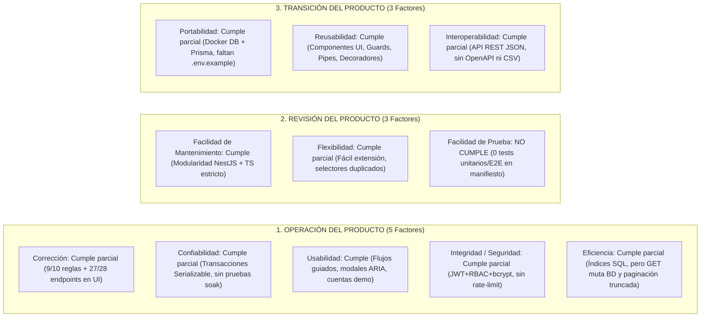
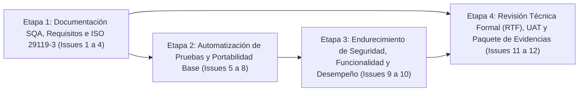

A continuación presento el **Informe Completo de Auditoría Técnica, Evaluación de Calidad de Producto y Aseguramiento de Calidad (SQA)** del sistema **ObraGest**, integrando todas las secciones desde el inicio para garantizar un documento único, continuo y autosuficiente.

---

# Informe de Auditoría Técnica, Evaluación de Calidad de Producto y Aseguramiento de Calidad (SQA) — Sistema ObraGest

**Proyecto evaluado:** ObraGest — Sistema de Administración de Inventario y Alquiler de Implementos de Construcción  
**Asignatura:** Ingeniería de Software II (Unidades 1 y 2)  
**Modo de auditoría:** Inspección estática en modo de solo lectura sobre los 104 archivos inventariados en el manifiesto oficial ([01-manifiesto-proyecto.md](file:///C:/Users/Zoraida%20Velasquez/Documents/vscode%20projects/ing-software-ii/.quality-context/01-manifiesto-proyecto.md#L1-L113)).  
**Fecha de corte de evaluación:** 9 de noviembre de 2026  

---

## 1. Resumen ejecutivo

El presente informe expone los resultados de la auditoría técnica y de calidad aplicada al sistema full-stack **ObraGest** ([README.md](file:///C:/Users/Zoraida%20Velasquez/Documents/vscode%20projects/ing-software-ii/README.md#L1-L679)), construido con **NestJS 11 + Prisma 6.19.3 + PostgreSQL 16** en el backend ([backend/package.json](file:///C:/Users/Zoraida%20Velasquez/Documents/vscode%20projects/ing-software-ii/backend/package.json#L21-L43)) y **React 19 + Vite 7 + React Router 7 + Tailwind CSS 3** en el frontend ([frontend/package.json](file:///C:/Users/Zoraida%20Velasquez/Documents/vscode%20projects/ing-software-ii/frontend/package.json#L11-L28)).

Siguiendo el marco conceptual de la asignatura (**Sesión 1, diapositivas 4, 6, 7 y 13**; **Sesión 3, diapositivas 2, 4, 10–13**; **Sesión 4, diapositivas 8–12**; **Sesión 6, diapositivas 4–16**; **Clase Pruebas del Software, diapositivas 4–29**), la auditoría evalúa tanto la **calidad del producto** —mediante **ISO/IEC 25010** y el **Modelo de McCall (1977)** bajo la jerarquía `factor → criterio → métrica`— como el **control y aseguramiento de la calidad del proceso y pruebas** —mediante **ISO/IEC/IEEE 29119-3**, complementado con prácticas de SQA (IEEE Std 730 / CMMI / PHVA) y Calidad Ágil (DoD, Criterios de Aceptación Gherkin e Integración Continua)—.

### Síntesis del estado actual del sistema

1. **Alta calidad de conformidad arquitectónica y de codificación estática (Producto):** El código fuente evidencia una arquitectura modular limpia en NestJS (8 módulos de dominio más Prisma y guardias globales en [app.module.ts](file:///C:/Users/Zoraida%20Velasquez/Documents/vscode%20projects/ing-software-ii/backend/src/app.module.ts#L17-L45)), integridad referencial y unicidad en base de datos ([schema.prisma](file:///C:/Users/Zoraida%20Velasquez/Documents/vscode%20projects/ing-software-ii/backend/prisma/schema.prisma#L37-L173)), control de concurrencia mediante transacciones `Serializable` en operaciones críticas de alquiler y devolución ([rentals.service.ts](file:///C:/Users/Zoraida%20Velasquez/Documents/vscode%20projects/ing-software-ii/backend/src/rentals/rentals.service.ts#L168-L255), [returns.service.ts](file:///C:/Users/Zoraida%20Velasquez/Documents/vscode%20projects/ing-software-ii/backend/src/returns/returns.service.ts#L191-L281)), validación estricta de DTOs con `class-validator` ([main.ts](file:///C:/Users/Zoraida%20Velasquez/Documents/vscode%20projects/ing-software-ii/backend/src/main.ts#L28-L35)) y una SPA responsiva con manejo consistente de estados de carga, error, modales accesibles (`role="dialog"`, `aria-modal="true"`) y vistas de impresión ([Modal.tsx](file:///C:/Users/Zoraida%20Velasquez/Documents/vscode%20projects/ing-software-ii/frontend/src/components/ui/Modal.tsx#L59-L88), [index.css](file:///C:/Users/Zoraida%20Velasquez/Documents/vscode%20projects/ing-software-ii/frontend/src/index.css#L69-L93)).
2. **Brecha crítica entre evidencia declarada y evidencia verificable en control de calidad (Proceso y Pruebas):** El archivo [README.md](file:///C:/Users/Zoraida%20Velasquez/Documents/vscode%20projects/ing-software-ii/README.md#L573-L580) declara la ejecución de *“34 comprobaciones E2E sobre la API real”* y *“15 comprobaciones E2E de interfaz en Chrome headless”*. Sin embargo, la auditoría del manifiesto de 104 archivos ([01-manifiesto-proyecto.md](file:///C:/Users/Zoraida%20Velasquez/Documents/vscode%20projects/ing-software-ii/.quality-context/01-manifiesto-proyecto.md#L9-L112)) demuestra que **existen cero (0) archivos de pruebas automatizadas** (`*.spec.ts`, `*.test.ts`, `*.e2e-spec.ts`), **cero (0) scripts de test** en los tres `package.json` ([package.json](file:///C:/Users/Zoraida%20Velasquez/Documents/vscode%20projects/ing-software-ii/package.json#L10-L24), [backend/package.json](file:///C:/Users/Zoraida%20Velasquez/Documents/vscode%20projects/ing-software-ii/backend/package.json#L6-L17), [frontend/package.json](file:///C:/Users/Zoraida%20Velasquez/Documents/vscode%20projects/ing-software-ii/frontend/package.json#L6-L10)), **cero (0) documentos de especificación de requisitos (SRS / Historias de Usuario)**, **cero (0) artefactos ISO/IEC/IEEE 29119-3** (plan de pruebas, casos de prueba de 8/12 campos, bitácoras de ejecución, reportes de defectos) y **ausencia de repositorio Git o pipeline de Integración Continua (CI)**.
3. **Riesgos técnicos puntuales en el producto:** Se identificaron brechas técnicas específicas que un jurado experto detectará al inspeccionar el código o probar el sistema: ausencia de limitación de tasa (*rate limiting*) o bloqueo por intentos fallidos en `POST /api/auth/login` ([auth.service.ts](file:///C:/Users/Zoraida%20Velasquez/Documents/vscode%20projects/ing-software-ii/backend/src/auth/auth.service.ts#L20-L56)), mutaciones de estado en peticiones `GET` mediante `markOverdueRentals()` ([rental-status.ts](file:///C:/Users/Zoraida%20Velasquez/Documents/vscode%20projects/ing-software-ii/backend/src/common/utils/rental-status.ts#L8-L20)), paginación truncada a 200 registros en el catálogo del frontend ([InventoryPage.tsx](file:///C:/Users/Zoraida%20Velasquez/Documents/vscode%20projects/ing-software-ii/frontend/src/pages/InventoryPage.tsx#L93-L95)), ausencia de interfaz gráfica para el endpoint `PATCH /api/auth/password` ([auth.controller.ts](file:///C:/Users/Zoraida%20Velasquez/Documents/vscode%20projects/ing-software-ii/backend/src/auth/auth.controller.ts#L32-L38)) y omisión de archivos `.env.example` en el manifiesto pese a que el `README.md` ordena copiarlos en el paso 1 de instalación ([README.md](file:///C:/Users/Zoraida%20Velasquez/Documents/vscode%20projects/ing-software-ii/README.md#L100-L103)).

| Dimensión Auditada | Modelo / Norma de Referencia | Nivel de Cumplimiento Global | Resumen de Evidencia |
| :--- | :--- | :---: | :--- |
| **Calidad de Producto (Estática y Arquitectónica)** | ISO/IEC 25010 | **Cumple parcialmente** | 8 características evaluadas: fuerte en Adecuación Funcional, Mantenibilidad (modularidad) y Usabilidad; brechas en Seguridad (fuerza bruta/almacenamiento token), Eficiencia (paginación en memoria y `GET` con `UPDATE`) y Portabilidad (`.env.example` ausentes). |
| **Factores de Calidad (Operación, Revisión, Transición)** | Modelo de McCall (1977) | **Cumple parcialmente** | 8/11 factores con soporte verificable en código; incumplimiento crítico en **Facilidad de prueba (Testability)** por inexistencia de suite automatizada y brecha en **Interoperabilidad / Portabilidad**. |
| **Control de Calidad y Documentación de Pruebas** | ISO/IEC/IEEE 29119-3 + SQA | **No cumple** | No existen en el repositorio planes de prueba, especificaciones de casos de prueba, matriz de trazabilidad ni actas de revisión técnica formal (RTF). Pruebas E2E solo declaradas en `README.md`. |

---

## 2. Fuentes, alcance y método

### 2.1 Inventario y catalogación de las fuentes teóricas del curso

El análisis se fundamenta estrictamente en las cinco presentaciones oficiales del curso extraídas en `.quality-context` ([00-fuentes-calidad.md](file:///C:/Users/Zoraida%20Velasquez/Documents/vscode%20projects/ing-software-ii/.quality-context/00-fuentes-calidad.md#L1-L35)):

| Fuente del Curso | Ruta en el Proyecto | Modelos, Estándares, Conceptos y Métricas Extraídos (con citación exacta) |
| :--- | :--- | :--- |
| **Sesión 1: Calidad del Software (Producto y Proceso)** | [Sesion1_Calidad_del_Software (1).txt](file:///C:/Users/Zoraida%20Velasquez/Documents/vscode%20projects/ing-software-ii/.quality-context/Sesion1_Calidad_del_Software%20(1).txt#L1-L165) | • **ISO 9000:2005 / ISO 9001:2015**: Definición de calidad como grado en que un conjunto de características inherentes cumple con los requisitos (*Sesión 1, diapositiva 4*). • **Producto vs. Proceso**: Relación entre proceso eficaz y producto útil (*Sesión 1, diapositivas 6 y 9*). • **Calidad del Diseño vs. Calidad de la Conformidad** (Pressman, 2010, p. 339): ¿El diseño cubre los casos de uso? vs. ¿El código respeta la arquitectura diseñada? (*Sesión 1, diapositiva 7*). • **ISO/IEC 25010**: Las 8 características de calidad del producto: Funcionalidad, Eficiencia, Compatibilidad, Usabilidad, Confiabilidad, Seguridad, Mantenibilidad y Portabilidad (*Sesión 1, diapositiva 11*). • **Jerarquía de capas QM ⊃ QA ⊃ QC ⊃ Testing** y ciclo Planificar → Gestionar → Controlar de Castro Bermúdez et al. (2019) (*Sesión 1, diapositivas 12 y 13*). |
| **Sesión 3: Gestión, Aseguramiento y Factores de la Calidad** | [Sesion3_Factores_Dimensiones_Calidad.txt](file:///C:/Users/Zoraida%20Velasquez/Documents/vscode%20projects/ing-software-ii/.quality-context/Sesion3_Factores_Dimensiones_Calidad.txt#L1-L316) | • **Gestión de Calidad (ISO 9001:2000)**: Política de calidad, sistema documentado, revisión y mejora continua (*Sesión 3, diapositiva 2*). • **Planificación de la Calidad**: Descomposición, EDT/WBS, red de tareas PERT/CPM y cronograma Gantt (*Sesión 3, diapositiva 3*). • **Aseguramiento de la Calidad del Software (SQA / ACS)** e **IEEE Std 730-1993**: Estándares, revisiones y auditorías, pruebas, administración del cambio, administración de proveedores y seguridad; Plan de ACS (*Sesión 3, diapositivas 4 y 5*). • **Estructura jerárquica de modelos**: `Factor → Criterio → Métrica` y distinción entre Medida, Medición y Métrica (*Sesión 3, diapositivas 8 y 10*). • **Modelo de McCall (1977)**: 11 factores en tres grupos: **Operación** (Corrección, Confiabilidad, Usabilidad, Integridad/Seguridad, Eficiencia/Performance), **Revisión** (Facilidad de mantenimiento, Flexibilidad, Facilidad de prueba) y **Transición** (Portabilidad, Reusabilidad, Interoperabilidad) (*Sesión 3, diapositivas 11, 12 y 13*). • **Dimensiones de Garvin (1987)**: Desempeño, Características, Confiabilidad, Conformidad, Durabilidad, Servicio, Estética y Percepción (*Sesión 3, diapositiva 14*). • **Dilema de la calidad** (“suficientemente bueno”) y **Costo de la Calidad** (Prevención, Evaluación, Falla interna, Falla externa; amplificación de US$977 en codificación a US$7,136 en pruebas de sistema según Boehm y Basili) (*Sesión 3, diapositivas 15 y 16*). |
| **Sesión 4: Modelos y Estándares / Síntesis y Método Ágil** | [Sesion4_Exposiciones - Sintesis-MetodoAgil.txt](file:///C:/Users/Zoraida%20Velasquez/Documents/vscode%20projects/ing-software-ii/.quality-context/Sesion4_Exposiciones%20-%20Sintesis-MetodoAgil.txt#L1-L235) | • **Articulación Producto + Proceso**: Modelos de producto (ISO/IEC 25010, McCall, Garvin) + Modelos de proceso (CMMI, PHVA/Kaizen) (*Sesión 4, diapositivas 4 y 8*). • **Calidad en equipos ágiles** (*Sesión 4, diapositiva 9*):   1. **Definición de Hecho (DoD)**: Acuerdo transversal (código revisado, pruebas unitarias pasando, criterios de aceptación, documentación, desplegado en QA, sin defectos críticos) (*Sesión 4, diapositiva 10*).   2. **Criterios de Aceptación por Historia de Usuario**: Formato Gherkin (`Dado / Cuando / Entonces`) definidos antes de desarrollar (*Sesión 4, diapositiva 11*).   3. **Integración Continua (CI)**: `Commit/Push → Build automático → Pruebas automatizadas → Feedback al equipo` (*Sesión 4, diapositiva 12*). |
| **Sesión 6: Verificación y Validación del Software** | [Sesion6_B1_Verificacion_Validacion.txt](file:///C:/Users/Zoraida%20Velasquez/Documents/vscode%20projects/ing-software-ii/.quality-context/Sesion6_B1_Verificacion_Validacion.txt#L1-L412) | • **Verificación vs. Validación**: Verificación (“¿construyendo bien el producto?”, técnica estática/revisión) vs. Validación (“¿construyendo el producto correcto?”, técnica dinámica/prueba) (*Sesión 6, diapositivas 4 y 5*). • **Amplificación del defecto**: Un error de diseño se multiplica al pasar a código (*Sesión 6, diapositivas 6 y 7*). • **4 Niveles de prueba**: Unidad, Integración, Sistema y Aceptación (*Sesión 6, diapositivas 8 y 9*). • **Puente con ISO/IEC 25010**: Mapeo directo entre cada prueba no funcional y una característica de ISO/IEC 25010 (*Sesión 6, diapositiva 11*). • **Escenario vs. Caso de prueba** y **Plantilla de 12 campos de caso de prueba** (*Sesión 6, diapositivas 13, 14, 15 y 16*). • **Revisión Técnica Formal (RTF — IEEE Std 1028)**: Roles (Moderador, Lector, Secretario, Revisores), decisiones (Aceptar, Aceptar provisionalmente, Rechazar), registros (Reporte técnico, Lista de pendientes) y métricas ($E_{revisión} = E_p + E_a + E_r$; $Densidad = Err_{tot} / TPT$) (*Sesión 6, diapositivas 17–21 y 27*). |
| **Clase Pruebas del Software: Tipos y Ejemplos (Unidad 2)** | [Clase_Pruebas_del_Software_Tipos_y_Ejemplos.txt](file:///C:/Users/Zoraida%20Velasquez/Documents/vscode%20projects/ing-software-ii/.quality-context/Clase_Pruebas_del_Software_Tipos_y_Ejemplos.txt#L1-L783) | • **Plantilla de caso de prueba documentado según ISO/IEC/IEEE 29119-3**: 8 campos esenciales (1. ID, 2. Objetivo, 3. Precondiciones, 4. Datos de prueba, 5. Pasos, 6. Resultado esperado [al diseñar]; 7. Resultado obtenido, 8. Estado PASA/FALLA [al ejecutar]) (*Clase Pruebas del Software, diapositiva 4*). • **Taxonomía de 20 tipos de prueba**: **8 Funcionales** (Unitarias, Integración, Sistema, Sanidad, Humo, Interfaz, Regresión, Aceptación) y **12 No Funcionales** (Rendimiento, Carga, Estrés, Volumen, Seguridad, Compatibilidad, Instalación, Recuperación, Confiabilidad, Usabilidad, Conformidad, Localización) (*Clase Pruebas del Software, diapositivas 5–27*). • **Distinción de pares críticos**: Humo vs. Sanidad, Integración vs. Interfaz, Carga vs. Estrés vs. Volumen, Rendimiento vs. Confiabilidad, Sistema vs. Aceptación (*Clase Pruebas del Software, diapositiva 28*). |

> [!NOTE]
> **Observación sobre el texto extraído de las diapositivas:** En [Sesion1_Calidad_del_Software (1).txt](file:///C:/Users/Zoraida%20Velasquez/Documents/vscode%20projects/ing-software-ii/.quality-context/Sesion1_Calidad_del_Software%20(1).txt#L59-L85) (diapositivas 5 y 9) y en [Sesion6_B1_Verificacion_Validacion.txt](file:///C:/Users/Zoraida%20Velasquez/Documents/vscode%20projects/ing-software-ii/.quality-context/Sesion6_B1_Verificacion_Validacion.txt#L62-L82) (diapositivas 6, 8, 12 y 17), el extractor de texto solo capturó el encabezado porque el contenido de esas láminas eran diagramas visuales. No obstante, las diapositivas contiguas de las mismas sesiones desglosan textualmente cada componente de esos diagramas (los 4 niveles de prueba en *Sesión 6, diapositiva 9*, las conclusiones del modelo de amplificación en *Sesión 6, diapositiva 7*, la plantilla de pruebas en *Sesión 6, diapositiva 14* y el proceso de RTF en *Sesión 6, diapositivas 18–21*), garantizando trazabilidad íntegra a las fuentes del curso.

### 2.2 Alcance y método de evaluación

Se auditaron los **104 archivos** inventariados en [01-manifiesto-proyecto.md](file:///C:/Users/Zoraida%20Velasquez/Documents/vscode%20projects/ing-software-ii/.quality-context/01-manifiesto-proyecto.md#L1-L113), aplicando **Verificación Estática (Inspección de Código, Esquema Relacional y Documentación)** conforme a la **Sesión 6, diapositivas 4 y 5**. En cumplimiento estricto de las reglas de auditoría, todo hallazgo distingue entre:
- **Evidencia verificable:** Presente y comprobable en líneas específicas de los archivos del manifiesto.
- **Evidencia declarada:** Afirmada en [README.md](file:///C:/Users/Zoraida%20Velasquez/Documents/vscode%20projects/ing-software-ii/README.md) sin artefacto verificable en el repositorio.
- **Evidencia no disponible / no verificable:** Artefacto inexistente en el manifiesto o métrica dinámica que exige ejecución en tiempo real.

---

## 3. Modelos aplicados y justificación

Tal como establece la síntesis docente de la **Sesión 4, diapositiva 8**, *“ningún modelo basta por sí solo: medir el producto (qué debe tener) y mejorar el proceso (cómo se construye) son complementarios — la misma idea de la cadena QM ⊃ QA ⊃ QC ⊃ Testing vista en la Sesión 1”*. Por ello se seleccionan tres modelos obligatorios y un complemento de aseguramiento ágil/proceso:

1. **ISO/IEC 25010 (Calidad de Producto):** Presentado en **Sesión 1, diapositiva 11**, **Sesión 3, diapositiva 7**, **Sesión 4, diapositivas 4 y 8** y **Sesión 6, diapositiva 11**. Es el estándar internacional vigente que organiza la calidad del producto en **8 características** (Adecuación Funcional, Eficiencia de Desempeño, Compatibilidad, Usabilidad, Fiabilidad, Seguridad, Mantenibilidad y Portabilidad) y conecta directamente con la batería de pruebas no funcionales de la **Unidad 2** (*Sesión 6, diapositiva 11*).
2. **Modelo de McCall, Richards y Walters, 1977 (Calidad de Producto — Operación, Revisión y Transición):** Desarrollado en **Sesión 3, diapositivas 10–13** y **Sesión 4, diapositivas 2, 4 y 8**. Aporta la estructura operacional `Factor → Criterio → Métrica` (*Sesión 3, diapositiva 10*) y permite evaluar tres perspectivas técnicas críticas en ObraGest: cómo opera en producción (**Operación**: 5 factores), cuánto cuesta modificarlo y probarlo (**Revisión**: 3 factores, incluyendo *Facilidad de prueba*) y cuán adaptable es a otros entornos (**Transición**: 3 factores).
3. **ISO/IEC/IEEE 29119-3:2021 (Control de Calidad y Documentación de Pruebas):** Referenciado explícitamente en **Clase Pruebas del Software, diapositivas 4 y 31** (y complementado por **ISO/IEC/IEEE 29119-1:2022** e **IEEE Std 1028-2008** en **Sesión 6, diapositiva 27**). Regula los artefactos formales de planificación, diseño de casos de prueba, ejecución, trazabilidad y reporte de defectos, permitiendo auditar con rigor por qué las pruebas declaradas en el `README.md` no constituyen evidencia verificable de control de calidad (QC).
4. **Complemento de Proceso y Calidad Ágil (SQA IEEE Std 730 / CMMI / PHVA + DoD, Gherkin y CI):** Justificado por **Sesión 3, diapositivas 4–5** y **Sesión 4, diapositivas 8–12**. Explica la causa raíz de los vacíos encontrados: la ausencia de un repositorio Git, de una *Definición de Hecho (DoD)* que exija pruebas unitarias/E2E versionadas y de un pipeline de *Integración Continua (CI)* sitúa al proceso en un nivel inicial/ad-hoc (CMMI Nivel 1) en lo relativo a verificación y validación documental.

---

## 4. Evaluación ISO/IEC 25010 (Calidad del Producto)

A continuación se evalúan las **8 características** de la norma **ISO/IEC 25010** (*Sesión 1, diapositiva 11*; *Sesión 6, diapositiva 11*) y sus subcaracterísticas relevantes frente a la evidencia del repositorio:

| Característica / Subcaracterística | Qué exige el modelo (ISO/IEC 25010 y Puente Unidad 2) | Evidencia encontrada en ObraGest (Verificable vs. Declarada) | Estado | Brecha o Riesgo | Criterio de Aceptación Propuesto (Verificable) | Evidencia o Prueba Necesaria para Demostrarlo | Prioridad |
| :--- | :--- | :--- | :---: | :--- | :--- | :--- | :---: |
| **1. Adecuación Funcional** *(Completitud, Corrección y Pertinencia funcional)* | Grado en que el software proporciona funciones que satisfacen las necesidades declaradas e implícitas, con resultados exactos (*Sesión 1, diap. 11*; *Sesión 6, diap. 11*). | **Verificable:** Implementación completa de los 8 módulos en backend ([app.module.ts](file:///C:/Users/Zoraida%20Velasquez/Documents/vscode%20projects/ing-software-ii/backend/src/app.module.ts#L17-L33)) y 13 páginas en frontend ([App.tsx](file:///C:/Users/Zoraida%20Velasquez/Documents/vscode%20projects/ing-software-ii/frontend/src/App.tsx#L48-L94)). Las 10 reglas de negocio del [README.md](file:///C:/Users/Zoraida%20Velasquez/Documents/vscode%20projects/ing-software-ii/README.md#L297-L309) están programadas: validación de `DISPONIBLE` y bloqueo de `ALQUILADO` manual ([items.service.ts](file:///C:/Users/Zoraida%20Velasquez/Documents/vscode%20projects/ing-software-ii/backend/src/items/items.service.ts#L108-L116), [#L175-L181](file:///C:/Users/Zoraida%20Velasquez/Documents/vscode%20projects/ing-software-ii/backend/src/items/items.service.ts#L175-L181)), código `ALQ-YYYYMMDD-00001` y congelación de `precioUnitario` ([rentals.service.ts](file:///C:/Users/Zoraida%20Velasquez/Documents/vscode%20projects/ing-software-ii/backend/src/rentals/rentals.service.ts#L213-L230)), devolución íntegra 1:1 ([returns.service.ts](file:///C:/Users/Zoraida%20Velasquez/Documents/vscode%20projects/ing-software-ii/backend/src/returns/returns.service.ts#L220-L233)) y protección del último `ADMIN` ([users.service.ts](file:///C:/Users/Zoraida%20Velasquez/Documents/vscode%20projects/ing-software-ii/backend/src/users/users.service.ts#L68-L88)). **Brecha verificable:** El endpoint `PATCH /api/auth/password` existe en backend ([auth.controller.ts](file:///C:/Users/Zoraida%20Velasquez/Documents/vscode%20projects/ing-software-ii/backend/src/auth/auth.controller.ts#L32-L38)), pero no tiene pantalla ni modal en el frontend (`frontend/src/pages/*`). | **Cumple parcialmente** | 1. Los usuarios (`EMPLEADO` o `ADMIN`) no pueden cambiar su propia contraseña desde la interfaz web. 2. No existe cálculo de costo total devengado por días reales de alquiler al devolver equipos (solo suma de tarifa diaria en [RentalDetailPage.tsx](file:///C:/Users/Zoraida%20Velasquez/Documents/vscode%20projects/ing-software-ii/frontend/src/pages/RentalDetailPage.tsx#L110-L113)). | **DADO** un usuario autenticado en la SPA, **CUANDO** abre la opción “Cambiar contraseña” e ingresa su clave actual y una nueva de $\ge 8$ caracteres, **ENTONCES** el frontend invoca `PATCH /api/auth/password` y muestra confirmación HTTP 200; además, el 100% de las 10 reglas de negocio pasan pruebas automatizadas. | Suite de pruebas de integración/E2E (`rentals.e2e-spec.ts`, `returns.e2e-spec.ts`) y modal o vista de cambio de contraseña conectada a `/api/auth/password`. | **Alta** |
| **2. Eficiencia de Desempeño** *(Comportamiento temporal, Utilización de recursos, Capacidad)* | Grado en que los tiempos de respuesta, procesamiento y uso de recursos cumplen los requisitos bajo condiciones determinadas (*Sesión 6, diap. 11*; *Clase Pruebas, diaps. 16–19*). | **Verificable:** Índices compuestos y simples en BD ([schema.prisma](file:///C:/Users/Zoraida%20Velasquez/Documents/vscode%20projects/ing-software-ii/backend/prisma/schema.prisma#L49), [#L66-L67](file:///C:/Users/Zoraida%20Velasquez/Documents/vscode%20projects/ing-software-ii/backend/prisma/schema.prisma#L66-L67), [#L97-L99](file:///C:/Users/Zoraida%20Velasquez/Documents/vscode%20projects/ing-software-ii/backend/prisma/schema.prisma#L97-L99), [#L120-L123](file:///C:/Users/Zoraida%20Velasquez/Documents/vscode%20projects/ing-software-ii/backend/prisma/schema.prisma#L120-L123)); consultas paralelas con `Promise.all` en dashboard ([reports.service.ts](file:///C:/Users/Zoraida%20Velasquez/Documents/vscode%20projects/ing-software-ii/backend/src/reports/reports.service.ts#L134-L169)); paginación servidor en `/items`, `/rentals` y `/returns`. **Brechas verificables:** 1. `InventoryPage.tsx` pide `pageSize: 200` fijo y filtra en memoria sin controles de página ([InventoryPage.tsx](file:///C:/Users/Zoraida%20Velasquez/Documents/vscode%20projects/ing-software-ii/frontend/src/pages/InventoryPage.tsx#L93-L95), [#L111-L126](file:///C:/Users/Zoraida%20Velasquez/Documents/vscode%20projects/ing-software-ii/frontend/src/pages/InventoryPage.tsx#L111-L126)). 2. `ClientsPage.tsx` y `UsersPage.tsx` traen toda la tabla sin paginar ([clients.service.ts](file:///C:/Users/Zoraida%20Velasquez/Documents/vscode%20projects/ing-software-ii/backend/src/clients/clients.service.ts#L29-L38)). 3. `markOverdueRentals()` ejecuta un `UPDATE` masivo en cada `GET` de alquileres, pendientes y reportes ([rental-status.ts](file:///C:/Users/Zoraida%20Velasquez/Documents/vscode%20projects/ing-software-ii/backend/src/common/utils/rental-status.ts#L8-L20)). 4. En devoluciones, se ejecuta un `tx.implemento.update` dentro de un bucle `for` secuencial en lugar de agrupar por `estadoFinal` ([returns.service.ts](file:///C:/Users/Zoraida%20Velasquez/Documents/vscode%20projects/ing-software-ii/backend/src/returns/returns.service.ts#L260-L265)). **No disponible:** Métricas reales de latencia ($p95$), carga o volumen. | **Cumple parcialmente** | 1. Si el catálogo supera 200 implementos, `InventoryPage` oculta silenciosamente el resto. 2. Ejecutar `UPDATE` en cada `GET` genera contención de escritura innecesaria bajo concurrencia. 3. No existen requisitos no funcionales (RNF) cuantitativos de tiempo de respuesta en el repositorio. | Con una BD de 1.000 implementos y 50 usuarios concurrentes durante 5 min, los endpoints `GET /api/items`, `GET /api/rentals` y `GET /api/reports/dashboard` responden con percentil 95 ($p95$) $\le 500\text{ ms}$ y tasa de error $< 1\%$, paginando el 100% de los registros en frontend. | Script reproducible de prueba de rendimiento/carga en k6 o JMeter (según *Clase Pruebas, diaps. 16–17*) y reporte de métricas $p95$ y throughput. | **Media** |
| **3. Compatibilidad** *(Coexistencia e Interoperabilidad)* | Grado en que un producto puede intercambiar información con otros sistemas y coexistir compartiendo entorno/recursos (*Sesión 1, diap. 11*; *Sesión 6, diap. 11*; *Clase Pruebas, diap. 21*). | **Verificable:** API REST sobre JSON con contratos tipados en [frontend/src/types/index.ts](file:///C:/Users/Zoraida%20Velasquez/Documents/vscode%20projects/ing-software-ii/frontend/src/types/index.ts#L1-L170), CORS parametrizable por lista de orígenes ([main.ts](file:///C:/Users/Zoraida%20Velasquez/Documents/vscode%20projects/ing-software-ii/backend/src/main.ts#L15-L26)), diseño responsivo con Tailwind CSS y hoja de estilos `@media print` ([index.css](file:///C:/Users/Zoraida%20Velasquez/Documents/vscode%20projects/ing-software-ii/frontend/src/index.css#L69-L93)). **Declarada:** Ejecución sin errores en Chrome headless ([README.md](file:///C:/Users/Zoraida%20Velasquez/Documents/vscode%20projects/ing-software-ii/README.md#L578)). **Brecha verificable:** No existe especificación OpenAPI/Swagger (`@nestjs/swagger`) ni exportación de reportes en formatos estándar de intercambio (CSV/JSON), solo `window.print()`. | **Cumple parcialmente** | 1. Otros sistemas no cuentan con contrato OpenAPI autogenerado ni exportación estructurada (CSV) como sí exige el taller del curso (*Sesión 6, diap. 23, RF-05*). 2. No hay matriz de pruebas de compatibilidad multi-navegador verificable (*Clase Pruebas, diap. 21*). | 1. La API expone contrato OpenAPI 3.0 en `/api/docs` o archivo versionado. 2. La interfaz renderiza y opera sin desbordamientos ni bloqueos en Chrome, Firefox y Edge (escritorio y vista móvil `375x812`). | Evidencia de prueba de compatibilidad (`CP-COM`) con capturas en matriz de 3 navegadores + especificación OpenAPI o exportación CSV en reportes. | **Media** |
| **4. Usabilidad** *(Reconocibilidad, Aprendizaje, Operabilidad, Protección contra errores de usuario, Estética, Accesibilidad)* | Grado en que el sistema puede ser usado por usuarios específicos para lograr objetivos con efectividad, eficiencia y satisfacción (*Sesión 6, diap. 11*; *Clase Pruebas, diaps. 25–26*). | **Verificable:** • *Aprendizaje/Reconocibilidad:* Botones de autocompletado de cuentas demo en [LoginPage.tsx](file:///C:/Users/Zoraida%20Velasquez/Documents/vscode%20projects/ing-software-ii/frontend/src/pages/LoginPage.tsx#L264-L290); estados vacíos guiados (`EmptyState`) en todas las vistas ([Feedback.tsx](file:///C:/Users/Zoraida%20Velasquez/Documents/vscode%20projects/ing-software-ii/frontend/src/components/ui/Feedback.tsx#L97-L129)). • *Protección contra errores:* Diálogos de confirmación (`ConfirmDialog`) antes de eliminar o desactivar ([Feedback.tsx](file:///C:/Users/Zoraida%20Velasquez/Documents/vscode%20projects/ing-software-ii/frontend/src/components/ui/Feedback.tsx#L199-L229)); deshabilitación de cambio de estado cuando un equipo está `ALQUILADO` ([InventoryPage.tsx](file:///C:/Users/Zoraida%20Velasquez/Documents/vscode%20projects/ing-software-ii/frontend/src/pages/InventoryPage.tsx#L513-L537)); botón “Todo en buen estado” en devoluciones ([NewReturnPage.tsx](file:///C:/Users/Zoraida%20Velasquez/Documents/vscode%20projects/ing-software-ii/frontend/src/pages/NewReturnPage.tsx#L116-L126)). • *Accesibilidad:* Uso de `aria-label`, `aria-modal="true"`, `role="dialog"`, `role="alertdialog"`, `role="status"` y cierre con tecla `Escape` ([Modal.tsx](file:///C:/Users/Zoraida%20Velasquez/Documents/vscode%20projects/ing-software-ii/frontend/src/components/ui/Modal.tsx#L38-L62), [Toast.tsx](file:///C:/Users/Zoraida%20Velasquez/Documents/vscode%20projects/ing-software-ii/frontend/src/components/Toast.tsx#L78-L89)). **No disponible:** Prueba con usuarios reales (SUS) ni auditoría de contraste WCAG 2.1 AA (WAVE/Lighthouse). | **Cumple parcialmente** | 1. Algunos textos secundarios usan `text-slate-400` sobre fondo blanco (`#94a3b8` sobre `#ffffff`, ratio $\approx 2.5:1$), inferior al mínimo de $4.5:1$ de WCAG 2.1 AA (*Clase Pruebas, diap. 26*). 2. No existe medición de escala SUS (*Clase Pruebas, diap. 25*). | 1. En una prueba de usabilidad con $\ge 5$ usuarios representativos, al menos el $80\%$ completa el flujo “Crear alquiler y registrar devolución” en $\le 3\text{ min}$ sin ayuda y el puntaje SUS promedio es $\ge 68$. 2. Auditoría Lighthouse/WAVE sin errores críticos de accesibilidad. | Protocolo y acta de prueba de usabilidad (`CP-USA-01`) con cálculo de SUS y reporte de accesibilidad Lighthouse/WAVE (*Clase Pruebas, diaps. 25 y 26*). | **Media** |
| **5. Fiabilidad** *(Madurez, Disponibilidad, Tolerancia a fallos, Capacidad de recuperación)* | Grado en que un sistema desempeña funciones específicas bajo condiciones definidas durante un período de tiempo (*Sesión 1, diap. 11*; *Clase Pruebas, diaps. 23–24*). | **Verificable:** • *Tolerancia a fallos y atomicidad:* Uso de transacciones `Prisma.TransactionIsolationLevel.Serializable` con timeout de 15 s y verificación `updated.count !== implementoIds.length` en alquileres ([rentals.service.ts](file:///C:/Users/Zoraida%20Velasquez/Documents/vscode%20projects/ing-software-ii/backend/src/rentals/rentals.service.ts#L168-L255)) y devoluciones ([returns.service.ts](file:///C:/Users/Zoraida%20Velasquez/Documents/vscode%20projects/ing-software-ii/backend/src/returns/returns.service.ts#L191-L281)). • *Manejo de excepciones:* Filtro global `PrismaExceptionFilter` que traduce códigos `P2002`, `P2003`, `P2025` y `P2034` a respuestas HTTP semánticas (`409 Conflict`, `404 Not Found`) sin exponer trazas SQL ([prisma-exception.filter.ts](file:///C:/Users/Zoraida%20Velasquez/Documents/vscode%20projects/ing-software-ii/backend/src/common/filters/prisma-exception.filter.ts#L11-L74)). • *Disponibilidad/Salud:* Endpoint `GET /api/health` ([app.controller.ts](file:///C:/Users/Zoraida%20Velasquez/Documents/vscode%20projects/ing-software-ii/backend/src/app.controller.ts#L6-L14)), `enableShutdownHooks()` ([main.ts](file:///C:/Users/Zoraida%20Velasquez/Documents/vscode%20projects/ing-software-ii/backend/src/main.ts#L13)) y `healthcheck` de contenedor en [docker-compose.yml](file:///C:/Users/Zoraida%20Velasquez/Documents/vscode%20projects/ing-software-ii/docker-compose.yml#L15-L24). **Brechas verificables:** 1. `GET /api/health` retorna `'ok'` estático sin comprobar conectividad real a PostgreSQL (`SELECT 1`). 2. En `rentals.service.ts` (#L205-L230) se inserta el alquiler con código temporal `TMP-${randomUUID()}` y luego se hace `update` al código definitivo `ALQ-...` en dos pasos dentro de la transacción. 3. No existe `ErrorBoundary` en React (`frontend/src/main.tsx`). | **Cumple parcialmente** | 1. Si PostgreSQL cae mientras el proceso Node sigue vivo, `GET /api/health` reporta falso positivo (`200 OK`). 2. Ante dos transacciones concurrentes en aislamiento `Serializable`, PostgreSQL lanza `P2034` (fallo de serialización); el código no tiene reintento automático, aunque el filtro informa al usuario. 3. Sin pruebas de recuperación o confiabilidad ejecutadas. | 1. `GET /api/health` verifica conexión activa con Prisma (`$queryRaw\`SELECT 1\``) y retorna `503` si la BD está caída. 2. Ante solicitudes concurrentes de alquiler sobre el mismo implemento, exactamente 1 recibe `201 Created` y el resto recibe `409 Conflict`, con $0$ registros inconsistentes en BD. | Prueba de concurrencia/recuperación (`CP-REC-01`) simulando doble alquiler simultáneo e interrupción de BD (*Clase Pruebas, diap. 23*). | **Alta** |
| **6. Seguridad** *(Confidencialidad, Integridad, No repudio, Responsabilidad, Autenticidad)* | Grado en que el sistema protege la información y los datos para que las personas o sistemas tengan el grado de acceso apropiado a sus roles (*Sesión 6, diap. 11*; *Clase Pruebas, diap. 20*). | **Verificable:** • Hash `bcryptjs` con 10 rondas ([auth.service.ts](file:///C:/Users/Zoraida%20Velasquez/Documents/vscode%20projects/ing-software-ii/backend/src/auth/auth.service.ts#L30-L33), [#L91](file:///C:/Users/Zoraida%20Velasquez/Documents/vscode%20projects/ing-software-ii/backend/src/auth/auth.service.ts#L91)) y omisión de `passwordHash` mediante `publicUserSelect` ([users.service.ts](file:///C:/Users/Zoraida%20Velasquez/Documents/vscode%20projects/ing-software-ii/backend/src/users/users.service.ts#L12-L19)). • `JwtAuthGuard` verifica en cada request que el usuario exista y siga `activo: true` en BD ([jwt-auth.guard.ts](file:///C:/Users/Zoraida%20Velasquez/Documents/vscode%20projects/ing-software-ii/backend/src/common/guards/jwt-auth.guard.ts#L50-L65)). • `RolesGuard` global ([roles.guard.ts](file:///C:/Users/Zoraida%20Velasquez/Documents/vscode%20projects/ing-software-ii/backend/src/common/guards/roles.guard.ts#L14-L43)), cabeceras `helmet()` y `ValidationPipe` con `whitelist: true` y `forbidNonWhitelisted: true` ([main.ts](file:///C:/Users/Zoraida%20Velasquez/Documents/vscode%20projects/ing-software-ii/backend/src/main.ts#L11-L35)). • Trazabilidad de autoría (`usuarioId`) en `Alquiler` y `Devolucion` ([schema.prisma](file:///C:/Users/Zoraida%20Velasquez/Documents/vscode%20projects/ing-software-ii/backend/prisma/schema.prisma#L107), [#L146](file:///C:/Users/Zoraida%20Velasquez/Documents/vscode%20projects/ing-software-ii/backend/prisma/schema.prisma#L146)). **Brechas verificables:** 1. **Sin protección contra fuerza bruta:** No hay `@nestjs/throttler` ni bloqueo de cuenta tras $N$ intentos fallidos en `POST /api/auth/login` (contrario a lo exigido en *Sesión 6, diap. 15, CP-RF01-03* y *Clase Pruebas, diap. 20, CP-SEG-05*). 2. **Política débil de contraseñas:** Solo valida longitud (`@MinLength(8)`, `@MaxLength(72)`) sin exigir complejidad ([create-user.dto.ts](file:///C:/Users/Zoraida%20Velasquez/Documents/vscode%20projects/ing-software-ii/backend/src/users/dto/create-user.dto.ts#L22-L25)). 3. **JWT en `localStorage`:** Almacenado en `localStorage` con vigencia de 8 h (`28800` s) sin mecanismo de revocación de token ([api.ts](file:///C:/Users/Zoraida%20Velasquez/Documents/vscode%20projects/ing-software-ii/frontend/src/lib/api.ts#L4), [#L15](file:///C:/Users/Zoraida%20Velasquez/Documents/vscode%20projects/ing-software-ii/frontend/src/lib/api.ts#L15)). | **Cumple parcialmente** | 1. El endpoint `/api/auth/login` es vulnerable a ataques de diccionario/fuerza bruta ilimitados. 2. Si un evaluador ejecuta el caso de prueba clásico del curso (*CP-SEG-05: 5 o 6 intentos fallidos seguidos*), el sistema no bloqueará ni limitará la petición. 3. No hay bitácora de auditoría para acciones destructivas o cambios de rol en `usuarios`, `clientes` o `implementos`. | 1. Tras 5 intentos fallidos de login desde la misma IP/cuenta en 15 min, la API responde `429 Too Many Requests` o bloquea temporalmente. 2. El 100% de los endpoints `@Roles(Rol.ADMIN)` rechazan con `403 Forbidden` tokens de `EMPLEADO` y con `401 Unauthorized` peticiones sin token o de usuarios desactivados. | Suite de pruebas de seguridad (`CP-SEG-01` a `CP-SEG-05`: inyección en DTOs, fuerza bruta, RBAC cruzado y desactivación de usuario en caliente). | **Crítica** |
| **7. Mantenibilidad** *(Modularidad, Reusabilidad, Analizabilidad, Capacidad de ser modificado, Capacidad de ser probado)* | Grado de efectividad y eficiencia con el que un producto puede ser modificado, corregido o probado (*Sesión 1, diap. 11*; *Sesión 3, diap. 13*; *Sesión 6, diap. 11*). | **Verificable (Positiva):** • Alta modularidad: 8 módulos NestJS desacoplados con controlador, servicio y DTOs propios ([app.module.ts](file:///C:/Users/Zoraida%20Velasquez/Documents/vscode%20projects/ing-software-ii/backend/src/app.module.ts#L17-L45)). • Tipado estricto (`"strict": true`) en ambos `tsconfig.json` ([backend/tsconfig.json](file:///C:/Users/Zoraida%20Velasquez/Documents/vscode%20projects/ing-software-ii/backend/tsconfig.json#L15), [frontend/tsconfig.json](file:///C:/Users/Zoraida%20Velasquez/Documents/vscode%20projects/ing-software-ii/frontend/tsconfig.json#L14)). • Componentes UI reutilizables (`Button`, `Modal`, `Badges`, `Feedback`, `Toast`). **Brechas verificables (Negativas):** 1. **Capacidad de ser probado (Testability) nula en artefactos:** 0 pruebas unitarias o de integración en los 104 archivos; sin `jest` ni `vitest` configurados ([backend/package.json](file:///C:/Users/Zoraida%20Velasquez/Documents/vscode%20projects/ing-software-ii/backend/package.json#L6-L43)). 2. **Duplicación de selectores Prisma:** `userSummary`, `clientSummary` e `itemSummary` están copiados literalmente en 3 servicios: [rentals.service.ts](file:///C:/Users/Zoraida%20Velasquez/Documents/vscode%20projects/ing-software-ii/backend/src/rentals/rentals.service.ts#L19-L43), [returns.service.ts](file:///C:/Users/Zoraida%20Velasquez/Documents/vscode%20projects/ing-software-ii/backend/src/returns/returns.service.ts#L18-L42) y [reports.service.ts](file:///C:/Users/Zoraida%20Velasquez/Documents/vscode%20projects/ing-software-ii/backend/src/reports/reports.service.ts#L8-L31). 3. Sin configuración de linter (`eslint` / `prettier`) ni control de versiones Git. | **Cumple parcialmente** | Cualquier modificación futura carece de red de seguridad de regresión (*Clase Pruebas, diap. 13*). Además, un cambio en los campos públicos de `Cliente` o `Implemento` obliga a editar múltiples archivos manualmente. | 1. Existen scripts `npm test` y `npm run test:e2e` funcionales en el repositorio. 2. Cobertura de pruebas unitarias $\ge 70\%$ en servicios de dominio (`rentals`, `returns`, `items`, `users`, `auth`). 3. Selectores comunes de Prisma centralizados en `common/`. | Ejecución verificable de Jest/Vitest con reporte de cobertura (`coverage/lcov-report`) y eliminación de duplicación en selectores. | **Crítica** |
| **8. Portabilidad** *(Adaptabilidad, Instalabilidad, Reemplazabilidad)* | Grado de efectividad y eficiencia con el que un sistema puede ser transferido de un entorno de hardware/software a otro (*Sesión 1, diap. 11*; *Sesión 3, diap. 13*; *Clase Pruebas, diap. 22*). | **Verificable:** • `docker-compose.yml` funcional para PostgreSQL 16 Alpine con volumen persistente y variables con valores por defecto ([docker-compose.yml](file:///C:/Users/Zoraida%20Velasquez/Documents/vscode%20projects/ing-software-ii/docker-compose.yml#L1-L28)). • Migraciones SQL versionadas ([migration.sql](file:///C:/Users/Zoraida%20Velasquez/Documents/vscode%20projects/ing-software-ii/backend/prisma/migrations/20261026120000_inicial/migration.sql#L1-L212)) y semilla idempotente con `upsert` ([seed.ts](file:///C:/Users/Zoraida%20Velasquez/Documents/vscode%20projects/ing-software-ii/backend/prisma/seed.ts#L27-L376)). **Brechas verificables:** 1. **Faltan archivos `.env.example`:** El [README.md](file:///C:/Users/Zoraida%20Velasquez/Documents/vscode%20projects/ing-software-ii/README.md#L61-L73) (y líneas 101–102, 143, 154, 169) afirma que existen `.env.example`, `backend/.env.example` y `frontend/.env.example` e instruye ejecutar `Copy-Item .env.example .env`. Sin embargo, **ninguno de esos tres archivos existe en el manifiesto** ([01-manifiesto-proyecto.md](file:///C:/Users/Zoraida%20Velasquez/Documents/vscode%20projects/ing-software-ii/.quality-context/01-manifiesto-proyecto.md#L9-L112)). Como [auth.module.ts](file:///C:/Users/Zoraida%20Velasquez/Documents/vscode%20projects/ing-software-ii/backend/src/auth/auth.module.ts#L13-L18) lanza un error fatal si falta `JWT_SECRET`, la instalación en otra máquina siguiendo el paso 1 del README falla de inmediato. 2. La sección 10.1 del [README.md](file:///C:/Users/Zoraida%20Velasquez/Documents/vscode%20projects/ing-software-ii/README.md#L349-L360) depende de scripts locales `%LOCALAPPDATA%\ObraGest\*.ps1` exclusivos del equipo del autor. 3. No hay `Dockerfile` para backend ni frontend. | **Cumple parcialmente** | Un evaluador externo que clone o descomprima los 104 archivos y ejecute el Paso 1 del `README.md` (`Copy-Item backend/.env.example backend/.env`) obtendrá `ItemNotFoundException`, y al iniciar el backend sin `backend/.env` obtendrá `Error: Falta la variable de entorno JWT_SECRET`. | Al descomprimir el repositorio en un entorno limpio con Node $\ge 20$ y PostgreSQL 16 (Docker o local), los archivos `.env.example` existen en las rutas documentadas y la secuencia `Copy-Item ... -> npm install -> npm run db:setup -> npm run build` finaliza en $\le 10\text{ min}$ con código de salida `0`. | Incorporación de `.env.example`, `backend/.env.example` y `frontend/.env.example` al inventario + caso de prueba de instalación (`CP-INS-01`, *Clase Pruebas, diap. 22*). | **Alta** |

---

## 5. Evaluación con el Modelo de McCall (1977)

Siguiendo la estructura jerárquica **`Factor → Criterio → Métrica`** definida en la **Sesión 3, diapositivas 10, 11, 12 y 13**, se evalúan los **11 factores de calidad de McCall** agrupados en **Operación**, **Revisión** y **Transición**, vinculando cada uno con los artefactos reales de ObraGest:

### 5.1 Resumen visual de los tres ejes de McCall en ObraGest

### 5.2 Matriz de evaluación detallada Factor → Criterio → Métrica (McCall)

| Grupo | Factor de McCall (*Sesión 3, diaps. 12–13*) | Criterio(s) de Calidad (Atributos Internos) | Métrica o Evidencia Observable en ObraGest (Archivos y Líneas) | Estado | Brecha Identificada | Criterio de Aceptación Verificable |
| :--- | :--- | :--- | :--- | :---: | :--- | :--- |
| **Operación** | **1. Corrección** *(Grado de cumplimiento de las especificaciones y objetivos del usuario)* | **Completitud**, **Consistencia** y **Trazabilidad** funcional frente a las reglas del negocio. | • **Reglas de negocio implementadas:** $10/10$ reglas declaradas en [README.md](file:///C:/Users/Zoraida%20Velasquez/Documents/vscode%20projects/ing-software-ii/README.md#L297-L309) tienen implementación verificable en los servicios de backend. • **Cobertura de endpoints en UI:** $26/28$ endpoints de la tabla [README.md](file:///C:/Users/Zoraida%20Velasquez/Documents/vscode%20projects/ing-software-ii/README.md#L384-L420) son consumidos por el frontend; `PATCH /api/auth/password` ([auth.controller.ts](file:///C:/Users/Zoraida%20Velasquez/Documents/vscode%20projects/ing-software-ii/backend/src/auth/auth.controller.ts#L32-L38)) y `GET /api/health` no tienen invocación en la SPA. • **Trazabilidad documental:** $0$ documentos formales de especificación de requisitos (SRS o Historias de Usuario) previos al código. | **Cumple parcialmente** | Ausencia de UI para cambio de contraseña propia (`PATCH /auth/password`) y falta de documento formal de requisitos contra el cual auditar completitud contractual. | $100\%$ de los endpoints de usuario tienen representación en la UI o justificación arquitectónica, y $100\%$ de las reglas de negocio cuentan con un requisito numerado (`RF-01` a `RF-12`) y prueba asociada. |
| **Operación** | **2. Confiabilidad** *(Grado en el que el sistema está disponible para usarse y opera sin fallar)* | **Tolerancia a errores**, **Precisión** de cálculos/estados y **Consistencia transaccional**. | • **Aislamiento transaccional:** $2/2$ operaciones críticas de mutación múltiple (`rentals.service.ts` [#L168-L255](file:///C:/Users/Zoraida%20Velasquez/Documents/vscode%20projects/ing-software-ii/backend/src/rentals/rentals.service.ts#L168-L255) y `returns.service.ts` [#L191-L281](file:///C:/Users/Zoraida%20Velasquez/Documents/vscode%20projects/ing-software-ii/backend/src/returns/returns.service.ts#L191-L281)) usan `Serializable` + validación de conteo actualizado. • **Precisión monetaria:** Uso de `Decimal(12, 2)` en PostgreSQL/Prisma ([schema.prisma](file:///C:/Users/Zoraida%20Velasquez/Documents/vscode%20projects/ing-software-ii/backend/prisma/schema.prisma#L88), [#L131](file:///C:/Users/Zoraida%20Velasquez/Documents/vscode%20projects/ing-software-ii/backend/prisma/schema.prisma#L131)) para evitar errores de coma flotante en precios. • **Estabilidad de fechas:** Normalización al mediodía UTC (`T12:00:00.000Z`) en [dates.ts](file:///C:/Users/Zoraida%20Velasquez/Documents/vscode%20projects/ing-software-ii/backend/src/common/utils/dates.ts#L7-L19) y [format.ts](file:///C:/Users/Zoraida%20Velasquez/Documents/vscode%20projects/ing-software-ii/frontend/src/lib/format.ts#L44-L60) para evitar desfase de $-1$ día por zona horaria `America/Bogota` (evitando el defecto ejemplificado en *Clase Pruebas, diap. 27, CP-LOC-01*). | **Cumple parcialmente** | `GET /api/health` no comprueba el estado real de PostgreSQL; falta `ErrorBoundary` en el árbol de React; no existen métricas dinámicas de MTBF ni pruebas de recuperación ejecutadas. | Cero ($0$) corrupciones de estado de inventario ante fallos inyectados a mitad de transacción y respuesta `503` en `/api/health` cuando PostgreSQL no está disponible. |
| **Operación** | **3. Usabilidad** *(Esfuerzo necesario para aprender a utilizar el sistema y operarlo)* | **Operabilidad**, **Comunicatividad** (mensajes claros en español) y **Facilidad de aprendizaje**. | • **Localización y mensajes:** $100\%$ de los mensajes de validación en DTOs (`login.dto.ts`, `create-item.dto.ts`, `create-rental.dto.ts`) y excepciones (`PrismaExceptionFilter` [#L28-L60](file:///C:/Users/Zoraida%20Velasquez/Documents/vscode%20projects/ing-software-ii/backend/src/common/filters/prisma-exception.filter.ts#L28-L60)) están redactados en español claro. • **Asistencia en UI:** Carga en 1 clic de credenciales demo ([LoginPage.tsx](file:///C:/Users/Zoraida%20Velasquez/Documents/vscode%20projects/ing-software-ii/frontend/src/pages/LoginPage.tsx#L66-L70)), resumen lateral interactivo de tarifa diaria en [NewRentalPage.tsx](file:///C:/Users/Zoraida%20Velasquez/Documents/vscode%20projects/ing-software-ii/frontend/src/pages/NewRentalPage.tsx#L431-L537) y contador de novedades en [NewReturnPage.tsx](file:///C:/Users/Zoraida%20Velasquez/Documents/vscode%20projects/ing-software-ii/frontend/src/pages/NewReturnPage.tsx#L452-L528). | **Cumple** | Contraste mejorable en textos auxiliares `text-slate-400` y falta de paginación visual en la vista de tarjetas de `InventoryPage.tsx`. | Tasa de finalización de tareas principales $\ge 80\%$ en primera interacción sin manual y contraste de texto $\ge 4.5:1$ en elementos informativos. |
| **Operación** | **4. Integridad / Seguridad** *(Grado en que se controla el acceso al programa o los datos por usuarios no autorizados)* | **Control de acceso**, **Auditoría de datos** y **Protección de credenciales**. | • **Cobertura de Guards:** $100\%$ de los controladores protegidos por `APP_GUARD` (`JwtAuthGuard` + `RolesGuard` en [app.module.ts](file:///C:/Users/Zoraida%20Velasquez/Documents/vscode%20projects/ing-software-ii/backend/src/app.module.ts#L34-L43)), con solo 2 rutas `@Public()` (`/health` y `/auth/login`). • **Verificación en tiempo real:** `JwtAuthGuard` consulta `prisma.usuario.findUnique` en cada petición para bloquear inmediatamente cuentas desactivadas ([jwt-auth.guard.ts](file:///C:/Users/Zoraida%20Velasquez/Documents/vscode%20projects/ing-software-ii/backend/src/common/guards/jwt-auth.guard.ts#L50-L65)). • **Integridad referencial:** `onDelete: Restrict` en 7 relaciones clave de [migration.sql](file:///C:/Users/Zoraida%20Velasquez/Documents/vscode%20projects/ing-software-ii/backend/prisma/migrations/20261026120000_inicial/migration.sql#L187-L211). | **Cumple parcialmente** | Ausencia total de *rate limiting* o bloqueo por intentos fallidos en `/auth/login`; ausencia de registro de auditoría de quién edita o elimina implementos, categorías o clientes. | Bloqueo temporal o limitación HTTP `429` a partir del 5.º intento fallido de inicio de sesión consecutivo y rechazo del $100\%$ de payloads con campos no autorizados (`400 Bad Request`). |
| **Operación** | **5. Eficiencia / Performance** *(Cantidad de recursos y código requeridos para realizar una función)* | **Eficiencia de ejecución** (consultas SQL e I/O) y **Eficiencia de almacenamiento**. | • **Índices en BD:** 16 índices (únicos y de búsqueda) creados en [migration.sql](file:///C:/Users/Zoraida%20Velasquez/Documents/vscode%20projects/ing-software-ii/backend/prisma/migrations/20261026120000_inicial/migration.sql#L120-L185). • **Ineficiencia detectada 1:** `markOverdueRentals()` ([rental-status.ts](file:///C:/Users/Zoraida%20Velasquez/Documents/vscode%20projects/ing-software-ii/backend/src/common/utils/rental-status.ts#L8-L20)) ejecuta un `UPDATE` en la tabla `alquileres` en 5 métodos de lectura (`rentals.findAll`, `rentals.findOne`, `returns.findPending`, `reports.getActiveRentals`, `reports.getDashboard`). • **Ineficiencia detectada 2:** `InventoryPage.tsx` descarga hasta 200 ítems de golpe y filtra en el navegador en lugar de usar los parámetros `search`, `estado` y `categoriaId` que ya implementa `ItemsService.findAll()` ([items.service.ts](file:///C:/Users/Zoraida%20Velasquez/Documents/vscode%20projects/ing-software-ii/backend/src/items/items.service.ts#L21-L57)). | **Cumple parcialmente** | Desaprovechamiento del filtrado y paginación del backend en `InventoryPage.tsx` y acoplamiento de escrituras (`UPDATE`) dentro de lecturas (`GET`). | El filtrado y paginación de inventario se delega al backend o soporta paginación completa, y la actualización en lote de devoluciones usa operaciones agrupadas sin bucles secuenciales `await` por ítem. |
| **Revisión** | **6. Facilidad de mantenimiento** *(Esfuerzo para localizar y corregir un error en un programa en funcionamiento)* | **Modularidad**, **Concisión** y **Autodescripción** del código. | • **Tamaño de archivos:** Los 63 archivos de backend tienen entre 4 y 283 líneas (máximo: [returns.service.ts](file:///C:/Users/Zoraida%20Velasquez/Documents/vscode%20projects/ing-software-ii/backend/src/returns/returns.service.ts#L1-L283) con 283 LOC; promedio en servicios $\approx 145$ LOC). • **Separación de responsabilidades:** 100% de las rutas HTTP están separadas en `*.controller.ts`, la lógica transaccional en `*.service.ts` y las reglas de entrada en `dto/*.dto.ts`. • **Mapeo de errores centralizado:** Un único filtro (`PrismaExceptionFilter`) traduce errores de persistencia. | **Cumple** | Ausencia de logs estructurados de negocio (solo se registran errores no controlados en `PrismaExceptionFilter` [#L63-L66](file:///C:/Users/Zoraida%20Velasquez/Documents/vscode%20projects/ing-software-ii/backend/src/common/filters/prisma-exception.filter.ts#L63-L66)). | Tiempo medio para localizar un defecto de lógica de negocio en su módulo correspondiente $\le 10\text{ min}$ gracias a la correspondencia 1:1 entre ruta API, controlador y servicio. |
| **Revisión** | **7. Flexibilidad** *(Esfuerzo requerido para modificar un software en funcionamiento)* | **Capacidad de expansión**, **Generalidad** e **Independencia de datos**. | • **Esquema evolutivo:** Uso de Prisma Migrate ([migration.sql](file:///C:/Users/Zoraida%20Velasquez/Documents/vscode%20projects/ing-software-ii/backend/prisma/migrations/20261026120000_inicial/migration.sql#L1-L212)) y congelación de `precioUnitario` en `DetalleAlquiler` ([schema.prisma](file:///C:/Users/Zoraida%20Velasquez/Documents/vscode%20projects/ing-software-ii/backend/prisma/schema.prisma#L131)), lo que permite cambiar tarifas de implementos sin alterar alquileres históricos. • **Rigidez detectada:** Duplicación de `userSummary`, `clientSummary` e `itemSummary` en 3 servicios distintos; estados codificados en `enum` rígidos tanto en Prisma como en mapas del frontend ([Badges.tsx](file:///C:/Users/Zoraida%20Velasquez/Documents/vscode%20projects/ing-software-ii/frontend/src/components/ui/Badges.tsx#L58-L107)). | **Cumple parcialmente** | Agregar un nuevo campo visible en el resumen de cliente o implemento exige modificar 3 servicios de backend y la interfaz `types/index.ts`. | Los selectores de proyección Prisma (`userSummary`, `clientSummary`, `itemSummary`) residen en un único archivo compartido en `backend/src/common/`. |
| **Revisión** | **8. Facilidad de prueba (Testability)** *(Esfuerzo requerido para probar un programa y verificar que cumple sus funciones)* | **Instrumentación**, **Simplicidad** y **Soporte de pruebas automatizadas**. | • **Inyección de dependencias (Positivo):** Todos los servicios de NestJS reciben `PrismaService` por constructor ([rentals.service.ts](file:///C:/Users/Zoraida%20Velasquez/Documents/vscode%20projects/ing-software-ii/backend/src/rentals/rentals.service.ts#L69)), lo que permite inyectar dobles de prueba (*mocks/stubs*, *Sesión 6, diap. 9*). Incluso existe [modules.module.ts](file:///C:/Users/Zoraida%20Velasquez/Documents/vscode%20projects/ing-software-ii/backend/src/modules.module.ts#L12) con el comentario `// Archivo de barril opcional para pruebas o imports externos`. • **Evidencia de pruebas en el repositorio (Negativo Crítico):** $0$ archivos `*.spec.ts` o `*.test.tsx`, $0$ dependencias de testing (`jest`, `@nestjs/testing`, `supertest`, `vitest`, `playwright`) en [backend/package.json](file:///C:/Users/Zoraida%20Velasquez/Documents/vscode%20projects/ing-software-ii/backend/package.json#L21-L43) y [frontend/package.json](file:///C:/Users/Zoraida%20Velasquez/Documents/vscode%20projects/ing-software-ii/frontend/package.json#L11-L28). | **No cumple** | Pese a que la arquitectura NestJS fue diseñada para ser altamente testeable (e incluso dejó preparado `ModulesModule`), **no se entregó ni una sola prueba automatizada ni el runner de pruebas configurado**. | Configuración funcional de Jest/Supertest en backend y Vitest/Playwright en frontend, con ejecución de un solo comando (`npm test`) que valide unitariamente e integralmente los módulos. |
| **Transición** | **9. Portabilidad** *(Esfuerzo para migrar un programa de un entorno de operación a otro)* | **Independencia de máquina/SO** y **Autocontención de configuración**. | • **Parametrización:** Uso de `ConfigModule.forRoot({ isGlobal: true })` ([app.module.ts](file:///C:/Users/Zoraida%20Velasquez/Documents/vscode%20projects/ing-software-ii/backend/src/app.module.ts#L19-L22)) y `import.meta.env.VITE_API_URL` ([api.ts](file:///C:/Users/Zoraida%20Velasquez/Documents/vscode%20projects/ing-software-ii/frontend/src/lib/api.ts#L7)). • **Brecha en manifiesto:** Omisión de los 3 archivos `.env.example` documentados en [README.md](file:///C:/Users/Zoraida%20Velasquez/Documents/vscode%20projects/ing-software-ii/README.md#L100-L103) y referencias a rutas locales de Windows (`%LOCALAPPDATA%\ObraGest`) en [README.md](file:///C:/Users/Zoraida%20Velasquez/Documents/vscode%20projects/ing-software-ii/README.md#L351-L368). | **Cumple parcialmente** | El proyecto no puede inicializarse siguiendo literalmente los comandos de su propio `README.md` en una máquina limpia porque faltan las plantillas `.env.example`. | Inclusión de `.env.example`, `backend/.env.example` y `frontend/.env.example` en el repositorio y verificación de arranque limpio multiplataforma (Windows/Linux con Docker). |
| **Transición** | **10. Reusabilidad** *(Esfuerzo para que el programa o parte de él se use en otro proyecto)* | **Generalidad**, **Modularidad** y **Desacoplamiento de componentes**. | • **Backend:** Guards (`JwtAuthGuard`, `RolesGuard`), decoradores (`@Roles`, `@Public`, `@CurrentUser`), utilidades de fechas ([dates.ts](file:///C:/Users/Zoraida%20Velasquez/Documents/vscode%20projects/ing-software-ii/backend/src/common/utils/dates.ts#L1-L35)) y `PrismaExceptionFilter` son directamente reutilizables en cualquier API NestJS + Prisma. • **Frontend:** Biblioteca interna de componentes en `frontend/src/components/ui/` ([Button.tsx](file:///C:/Users/Zoraida%20Velasquez/Documents/vscode%20projects/ing-software-ii/frontend/src/components/ui/Button.tsx#L1-L183), [Modal.tsx](file:///C:/Users/Zoraida%20Velasquez/Documents/vscode%20projects/ing-software-ii/frontend/src/components/ui/Modal.tsx#L1-L101), [Feedback.tsx](file:///C:/Users/Zoraida%20Velasquez/Documents/vscode%20projects/ing-software-ii/frontend/src/components/ui/Feedback.tsx#L1-L267)) y sistema de notificaciones `Toast.tsx` totalmente independientes del dominio de construcción. | **Cumple** | Algunos componentes en `Badges.tsx` (`ItemStatusBadge`, `RentalStatusBadge`) mezclan la primitiva visual `Badge` con los estados específicos del dominio ObraGest. | Al menos el $80\%$ de los artefactos de `backend/src/common/` y `frontend/src/components/ui/` no tienen dependencias hacia entidades de negocio específicas. |
| **Transición** | **11. Interoperabilidad** *(Esfuerzo para que un sistema opere conjuntamente con otro)* | **Estandarización de datos**, **Contratos de interfaz** y **Protocolos estándar**. | • **Estándares:** Uso de HTTP/REST, códigos de estado semánticos (`200`, `201`, `400`, `401`, `403`, `404`, `409`), tokens estándar `Bearer JWT` (RFC 7519) y fechas ISO 8601 UTC. • **Faltantes:** Sin documentación interactiva OpenAPI/Swagger, sin webhooks ni exportación de datos tabulares (CSV/Excel) en el módulo de reportes ([reports.controller.ts](file:///C:/Users/Zoraida%20Velasquez/Documents/vscode%20projects/ing-software-ii/backend/src/reports/reports.controller.ts#L1-L31)). | **Cumple parcialmente** | Un sistema externo contable o de BI no puede consumir un esquema OpenAPI formal ni descargar reportes en CSV desde la API. | Exposición de especificación OpenAPI o endpoint/función de exportación CSV para los reportes de inventario y alquileres activos. |

---

## 6. Evaluación ISO/IEC/IEEE 29119-3 y Aseguramiento de Calidad (SQA)

Las fuentes del curso establecen que las pruebas son una función de control de calidad (QC) dentro del paraguas `QM ⊃ QA ⊃ QC ⊃ Testing` (**Sesión 1, diapositivas 12–13**; **Sesión 3, diapositivas 4–5**) y que la documentación de pruebas se rige por **ISO/IEC/IEEE 29119-3:2021** (**Clase Pruebas del Software, diapositivas 4 y 31**) y las técnicas de revisión por **IEEE Std 1028-2008** (**Sesión 6, diapositivas 18–21 y 27**).

### 6.1 Auditoría de artefactos de control de calidad y pruebas (ISO/IEC/IEEE 29119-3)

| Artefacto / Práctica Exigida por ISO/IEC/IEEE 29119-3 y el Curso | Referencia en Fuentes del Curso | Evidencia Encontrada en el Repositorio ObraGest | Estado | Brecha de Auditoría | Evidencia Mínima que Debe Existir para los Dos Grupos de Expertos |
| :--- | :--- | :--- | :---: | :--- | :--- |
| **1. Política y Plan de Pruebas / Plan de ACS (SQA)** | *Sesión 3, diaps. 2, 4 y 5* (Plan de ACS IEEE 730); *Sesión 6, diap. 12* (6 pasos del plan de pruebas). | **Evidencia verificable:** Ninguna. En [README.md](file:///C:/Users/Zoraida%20Velasquez/Documents/vscode%20projects/ing-software-ii/README.md#L514-L527) solo existe una sección informal de 11 pasos llamada *“13. Flujo de prueba sugerido”*. | **No cumple** | No existe un Plan de Pruebas ni Plan de ACS que defina alcance, riesgos, entorno de prueba, herramientas, roles y criterios de aceptación. | Documento `docs/qa/01-plan-pruebas-sqa.md` alineado con ISO/IEC/IEEE 29119-3 (alcance, ítems bajo prueba, estrategia por niveles, entorno, riesgos y calendario). |
| **2. Estrategia por Niveles de Prueba (Unidad, Integración, Sistema, Aceptación)** | *Sesión 6, diaps. 8 y 9* (Tabla de los 4 niveles); *Clase Pruebas, diaps. 7–9 y 14*. | **Evidencia declarada:** El [README.md](file:///C:/Users/Zoraida%20Velasquez/Documents/vscode%20projects/ing-software-ii/README.md#L577-L578) menciona comprobaciones E2E de API (34) y de interfaz (15). **Evidencia verificable:** $0$ pruebas unitarias, $0$ pruebas de integración, $0$ pruebas de sistema y $0$ actas de aceptación en el manifiesto. | **No cumple** | Se omitieron por completo las pruebas unitarias (caja blanca con dobles de prueba sobre servicios) y las pruebas de integración/sistema versionadas en el repositorio. | Scripts ejecutables en el repositorio para al menos 3 niveles: Unitarias (`*.spec.ts` en servicios), Integración/API (`*.e2e-spec.ts` con Supertest) y Sistema/Aceptación (guion E2E + acta UAT). |
| **3. Especificación de Casos de Prueba (Plantilla de 8 / 12 campos)** | *Sesión 6, diaps. 13–16* (Escenario vs. Caso; plantilla de 12 campos); *Clase Pruebas, diap. 4 y 29* (Plantilla ISO 29119-3 de 8 campos). | **Evidencia verificable:** Ninguna. La sección 13 del [README.md](file:///C:/Users/Zoraida%20Velasquez/Documents/vscode%20projects/ing-software-ii/README.md#L514-L527) describe escenarios generales sin ID único, sin precondiciones formales, sin datos de entrada concretos (válidos/inválidos/valores límite) ni resultados esperados binarios (sí/no). | **No cumple** | Tal como advierte la *Sesión 6, diapositiva 13*, “Escenario de prueba no es lo mismo que caso de prueba”. El proyecto solo tiene un escenario narrativo en el README. | Catálogo `docs/qa/02-casos-de-prueba.md` con mínimo 25–30 casos documentados en la plantilla de 8/12 campos de ISO/IEC/IEEE 29119-3, incluyendo valores límite y casos negativos. |
| **4. Datos de Prueba (Sintéticos, Válidos, Inválidos y Frontera)** | *Sesión 6, diaps. 14 y 22*; *Clase Pruebas, diaps. 3, 4 y 19* (datos sintéticos/ficticios). | **Evidencia verificable:** El archivo [backend/prisma/seed.ts](file:///C:/Users/Zoraida%20Velasquez/Documents/vscode%20projects/ing-software-ii/backend/prisma/seed.ts#L1-L385) carga un conjunto sintético idempotente excelente: 2 usuarios (`ADMIN` y `EMPLEADO`), 5 categorías, 12 implementos (en estados `DISPONIBLE`, `ALQUILADO`, `MANTENIMIENTO` y `FUERA_DE_SERVICIO`), 3 clientes y 3 alquileres (`ACTIVO`, `VENCIDO`, `FINALIZADO`). | **Cumple parcialmente** | El `seed.ts` cubre muy bien los datos base positivos, pero no existe un catálogo documentado de **datos de entrada inválidos y de valor límite** (ej. precio `0` o `-100`, fecha ayer, contraseña de 7 y 73 caracteres, implementos duplicados en array). | Tabla formal de particiones de equivalencia y valores límite para entradas de DTOs vinculada a los casos de prueba negativos y al `seed.ts`. |
| **5. Criterios de Entrada y Salida / Definición de Hecho (DoD)** | *Sesión 4, diaps. 9 y 10* (Checklist de DoD); *Clase Pruebas, diap. 11* (Prueba de humo como filtro de entrada del build). | **Evidencia verificable:** Ninguna. No hay documento de criterios de entrada (ej. prueba de humo `CP-HUM-01` aprobada antes de probar a fondo) ni criterios de salida/suspensión ni checklist de DoD. | **No cumple** | Sin criterios de salida medibles (ej. $100\%$ de casos críticos aprobados, $0$ defectos mayores abiertos), la afirmación de “validación completada” en el README es subjetiva. | Definición explícita de Criterios de Entrada, Suspensión, Reanudación y Salida en el Plan de Pruebas + checklist de DoD cumplido por módulo. |
| **6. Trazabilidad Requisito → Caso de Prueba → Resultado** | *Sesión 6, diaps. 2, 14, 25 y 26* (“Sin requisito asociado no hay trazabilidad”); *Clase Pruebas, diaps. 4 y 30*. | **Evidencia verificable:** Ninguna. No existen identificadores de requisitos (`RF-XX`, `RNF-XX`) ni identificadores de casos (`CP-XX`) en ningún archivo del manifiesto. | **No cumple** | La trazabilidad está completamente rota a nivel documental (*Sesión 6, diap. 25*): no se puede demostrar qué requisito originó cada endpoint ni qué caso de prueba lo verificó. | Matriz de Trazabilidad Bidireccional (`RF/RNF ↔ Endpoint/Página ↔ Caso de Prueba CP-* ↔ Script Automatizado ↔ Estado de Ejecución`). |
| **7. Evidencia de Ejecución de Pruebas (Logs, Reportes, Capturas)** | *Sesión 6, diap. 14* (Campos Resultado obtenido y Estado); *Clase Pruebas, diap. 4* (Campos 7 y 8 se llenan al ejecutar). | **Evidencia declarada:** [README.md](file:///C:/Users/Zoraida%20Velasquez/Documents/vscode%20projects/ing-software-ii/README.md#L575-L579) declara build exitoso, 34 pruebas E2E de API y 15 E2E de UI. **Evidencia verificable:** Solo existen dos artefactos residuales de compilación TypeScript en el frontend ([tsconfig.tsbuildinfo](file:///C:/Users/Zoraida%20Velasquez/Documents/vscode%20projects/ing-software-ii/frontend/tsconfig.tsbuildinfo) y [tsconfig.node.tsbuildinfo](file:///C:/Users/Zoraida%20Velasquez/Documents/vscode%20projects/ing-software-ii/frontend/tsconfig.node.tsbuildinfo)). No hay reportes JUnit/JSON, ni logs de ejecución de las 34+15 pruebas, ni capturas. | **No cumple** | Un auditor no puede dar por válidas 49 pruebas E2E de las cuales no existe ni el código fuente que las ejecuta ni el log/reporte de salida con fecha y hora. | Scripts automatizados en el repositorio + archivo de reporte de ejecución (`test-results.json` / salida de consola fechada) + bitácora de ejecución firmada. |
| **8. Gestión de Defectos y Revisiones Técnicas Formales (RTF)** | *Sesión 6, diaps. 18–21* (RTF, Reporte técnico, Lista de pendientes, métricas $E_p, E_a, E_r$ y densidad de error); *Clase Pruebas, diap. 4*. | **Evidencia verificable:** Ninguna. No hay registro histórico de defectos encontrados y corregidos (`DEF-XX`), ni actas de Revisión Técnica Formal (RTF), ni cálculo de densidad de errores. | **No cumple** | Tal como señala la *Sesión 6, diapositiva 20*: *“Tome notas por escrito. Un hallazgo que no queda registrado, no existe”*. | Bitácora de defectos (`docs/qa/04-registro-defectos.md`) y al menos 1 Acta de Revisión Técnica Formal (RTF) con roles, lista de verificación y cálculo de $E_{revisión}$ y densidad de error. |
| **9. Pruebas de Regresión e Integración Continua (CI)** | *Sesión 4, diap. 12* (Pipeline CI); *Clase Pruebas, diap. 13* (Pruebas de regresión `CP-REG`). | **Evidencia verificable:** No existe carpeta `.github/workflows`, ni repositorio `.git`, ni suite de regresión automatizada. | **No cumple** | Cualquier cambio de última hora antes de la sustentación puede introducir regresiones inadvertidas (“efecto colateral”, *Clase Pruebas, diap. 13*). | Suite de regresión ejecutable mediante `npm run test:regression` y configuración de workflow CI (`.github/workflows/ci.yml`). |
| **10. Criterios de Aceptación (Gherkin) y Pruebas de Aceptación (UAT)** | *Sesión 4, diap. 11* (Formato Gherkin `Dado / Cuando / Entonces`); *Clase Pruebas, diap. 14* (`CP-ACE` y acta firmada). | **Evidencia verificable:** Ninguna historia de usuario con criterios Gherkin ni acta de aceptación en el repositorio. | **No cumple** | No se puede demostrar validación con el usuario/cliente (*“¿Construimos el producto correcto?”*, *Sesión 6, diap. 4*). | Documento de Historias de Usuario con criterios en formato Gherkin y Acta de Pruebas de Aceptación (UAT) diligenciada. |

---

## 7. Matriz de trazabilidad del sistema

Dado que en el repositorio **no existe un documento formal de especificación de requisitos (SRS)** —lo cual se registra como un **vacío documental crítico**—, la siguiente matriz reconstruye la trazabilidad conectando cada **funcionalidad/regla de negocio declarada en el `README.md`** con su **característica ISO/IEC 25010 y factor de McCall**, su **criterio de aceptación verificable**, la **evidencia real verificada en código** y el **artefacto o prueba que falta** en el repositorio:

| ID / Funcionalidad o Regla de Negocio (Origen en `README.md`) |Estado Documental del Requisito | Característica ISO 25010 / Factor McCall | Criterio de Aceptación Verificable (Formato Gherkin / Medible) | Evidencia Verificable en el Código del Proyecto (Ruta y Líneas) | Prueba o Artefacto que Falta en el Manifiesto |
| :--- | :---: | :--- | :--- | :--- | :--- |
| **RF-01 (Implícito):** Autenticación con email/password, hash bcrypt y emisión de JWT ([README.md](file:///C:/Users/Zoraida%20Velasquez/Documents/vscode%20projects/ing-software-ii/README.md#L14), [#L387](file:///C:/Users/Zoraida%20Velasquez/Documents/vscode%20projects/ing-software-ii/README.md#L387)). | **Vacío documental** *(Solo en README)* | **Seguridad** (Autenticidad) / **Integridad (McCall)** | **DADO** un usuario activo con credenciales válidas, **CUANDO** envía `POST /api/auth/login`, **ENTONCES** recibe HTTP `200` con `accessToken` JWT y perfil sin `passwordHash`; si está inactivo o la clave falla, recibe `401`. | • Backend: [auth.controller.ts](file:///C:/Users/Zoraida%20Velasquez/Documents/vscode%20projects/ing-software-ii/backend/src/auth/auth.controller.ts#L20-L25), [auth.service.ts](file:///C:/Users/Zoraida%20Velasquez/Documents/vscode%20projects/ing-software-ii/backend/src/auth/auth.service.ts#L20-L56), [login.dto.ts](file:///C:/Users/Zoraida%20Velasquez/Documents/vscode%20projects/ing-software-ii/backend/src/auth/dto/login.dto.ts#L3-L10). • Frontend: [LoginPage.tsx](file:///C:/Users/Zoraida%20Velasquez/Documents/vscode%20projects/ing-software-ii/frontend/src/pages/LoginPage.tsx#L50-L64), [AuthContext.tsx](file:///C:/Users/Zoraida%20Velasquez/Documents/vscode%20projects/ing-software-ii/frontend/src/auth/AuthContext.tsx#L68-L76). | • Especificación formal `RF-01`. • Prueba unitaria `auth.service.spec.ts`. • Prueba de seguridad `CP-SEG-05` (bloqueo por fuerza bruta, hoy ausente en código). |
| **RF-02 (Implícito):** Cambio de contraseña del usuario autenticado ([README.md](file:///C:/Users/Zoraida%20Velasquez/Documents/vscode%20projects/ing-software-ii/README.md#L389)). | **Vacío documental** *(Solo en README)* | **Adecuación Funcional** (Completitud) / **Corrección (McCall)** | **DADO** un usuario autenticado, **CUANDO** envía `PATCH /api/auth/password` con `currentPassword` correcta y `newPassword` diferente ($\ge 8$ caracteres), **ENTONCES** actualiza el hash en BD y responde HTTP `200`. | • Backend: [auth.controller.ts](file:///C:/Users/Zoraida%20Velasquez/Documents/vscode%20projects/ing-software-ii/backend/src/auth/auth.controller.ts#L32-L38), [auth.service.ts](file:///C:/Users/Zoraida%20Velasquez/Documents/vscode%20projects/ing-software-ii/backend/src/auth/auth.service.ts#L62-L98), [change-password.dto.ts](file:///C:/Users/Zoraida%20Velasquez/Documents/vscode%20projects/ing-software-ii/backend/src/auth/dto/change-password.dto.ts#L3-L12). • Frontend: **No implementado en UI**. | • Modal/vista en frontend para invocar `PATCH /api/auth/password`. • Caso de prueba `CP-INT-AUTH-02` (clave actual errónea, clave repetida, clave válida). |
| **RF-03 (Implícito):** Control de acceso por roles `ADMIN` y `EMPLEADO` ([README.md](file:///C:/Users/Zoraida%20Velasquez/Documents/vscode%20projects/ing-software-ii/README.md#L15), [#L312-L326](file:///C:/Users/Zoraida%20Velasquez/Documents/vscode%20projects/ing-software-ii/README.md#L312-L326)). | **Vacío documental** *(Tabla en README)* | **Seguridad** (Confidencialidad y Autorización) / **Integridad (McCall)** | **DADO** un usuario con rol `EMPLEADO`, **CUANDO** intenta acceder a `/users`, `/categories`, `/reports/*` o `POST/PATCH/DELETE /items` y `DELETE /clients/:id`, **ENTONCES** la API responde `403 Forbidden` y la SPA redirige a `/inventario`. | • Backend: [jwt-auth.guard.ts](file:///C:/Users/Zoraida%20Velasquez/Documents/vscode%20projects/ing-software-ii/backend/src/common/guards/jwt-auth.guard.ts#L20-L75), [roles.guard.ts](file:///C:/Users/Zoraida%20Velasquez/Documents/vscode%20projects/ing-software-ii/backend/src/common/guards/roles.guard.ts#L14-L43), `@Roles(Rol.ADMIN)` en controladores. • Frontend: `AdminOnly` en [App.tsx](file:///C:/Users/Zoraida%20Velasquez/Documents/vscode%20projects/ing-software-ii/frontend/src/App.tsx#L32-L38), filtro de menú en [Layout.tsx](file:///C:/Users/Zoraida%20Velasquez/Documents/vscode%20projects/ing-software-ii/frontend/src/components/Layout.tsx#L52-L54). | • Prueba automatizada de matriz RBAC (`rbac.e2e-spec.ts`) que verifique los 28 endpoints con token de `ADMIN`, `EMPLEADO` y anónimo. |
| **RF-04 / Regla 9:** Gestión de usuarios y protección del último administrador activo y de la propia cuenta ([README.md](file:///C:/Users/Zoraida%20Velasquez/Documents/vscode%20projects/ing-software-ii/README.md#L307)). | **Vacío documental** *(Regla 9 en README)* | **Fiabilidad** / **Corrección e Integridad (McCall)** | **DADO** un administrador activo, **CUANDO** intenta desactivar su propia cuenta o degradar/desactivar al único `ADMIN` activo del sistema, **ENTONCES** recibe `400 Bad Request` y el cambio no se persiste. | • Backend: [users.service.ts](file:///C:/Users/Zoraida%20Velasquez/Documents/vscode%20projects/ing-software-ii/backend/src/users/users.service.ts#L68-L88). • Frontend: Botón de desactivación deshabilitado cuando `isSelf && user.activo` en [UsersPage.tsx](file:///C:/Users/Zoraida%20Velasquez/Documents/vscode%20projects/ing-software-ii/frontend/src/pages/UsersPage.tsx#L361), [#L528](file:///C:/Users/Zoraida%20Velasquez/Documents/vscode%20projects/ing-software-ii/frontend/src/pages/UsersPage.tsx#L528). | • Caso de prueba unitario y de integración de valor límite (`activeAdmins === 1`) en `users.service.spec.ts`. |
| **RF-05 / Reglas 2 y 8:** Catálogo de categorías e implementos; prohibición de asignar `ALQUILADO` manualmente o borrar con historial ([README.md](file:///C:/Users/Zoraida%20Velasquez/Documents/vscode%20projects/ing-software-ii/README.md#L17), [#L300](file:///C:/Users/Zoraida%20Velasquez/Documents/vscode%20projects/ing-software-ii/README.md#L300), [#L306](file:///C:/Users/Zoraida%20Velasquez/Documents/vscode%20projects/ing-software-ii/README.md#L306)). | **Vacío documental** *(Reglas 2 y 8 en README)* | **Adecuación Funcional** / **Corrección (McCall)** | **DADO** un `ADMIN`, **CUANDO** intenta crear o editar un implemento con `estado: "ALQUILADO"` manual o eliminar un implemento con registros en `detalle_alquileres`, **ENTONCES** recibe `400 Bad Request` o `409 Conflict` respectivamente. | • Backend: `assertManualState()` y validación de historial en [items.service.ts](file:///C:/Users/Zoraida%20Velasquez/Documents/vscode%20projects/ing-software-ii/backend/src/items/items.service.ts#L106-L116), [#L141-L162](file:///C:/Users/Zoraida%20Velasquez/Documents/vscode%20projects/ing-software-ii/backend/src/items/items.service.ts#L141-L162), [#L175-L181](file:///C:/Users/Zoraida%20Velasquez/Documents/vscode%20projects/ing-software-ii/backend/src/items/items.service.ts#L175-L181); [categories.service.ts](file:///C:/Users/Zoraida%20Velasquez/Documents/vscode%20projects/ing-software-ii/backend/src/categories/categories.service.ts#L63-L81). • Frontend: `MANUAL_STATES` en [InventoryPage.tsx](file:///C:/Users/Zoraida%20Velasquez/Documents/vscode%20projects/ing-software-ii/frontend/src/pages/InventoryPage.tsx#L61-L65). | • Pruebas unitarias de `ItemsService` y `CategoriesService`. • Controles de paginación en `InventoryPage.tsx` para catálogos $> 200$ ítems. |
| **RF-06 / Regla 8:** Gestión de clientes con búsqueda multicriterio y bloqueo de eliminación si posee alquileres ([README.md](file:///C:/Users/Zoraida%20Velasquez/Documents/vscode%20projects/ing-software-ii/README.md#L18), [#L306](file:///C:/Users/Zoraida%20Velasquez/Documents/vscode%20projects/ing-software-ii/README.md#L306)). | **Vacío documental** *(Regla 8 en README)* | **Adecuación Funcional** / **Corrección (McCall)** | **DADO** un cliente con `_count.alquileres > 0`, **CUANDO** un `ADMIN` envía `DELETE /api/clients/:id`, **ENTONCES** el sistema rechaza la operación con `409 Conflict` y conserva el cliente. | • Backend: [clients.service.ts](file:///C:/Users/Zoraida%20Velasquez/Documents/vscode%20projects/ing-software-ii/backend/src/clients/clients.service.ts#L15-L38), [#L97-L115](file:///C:/Users/Zoraida%20Velasquez/Documents/vscode%20projects/ing-software-ii/backend/src/clients/clients.service.ts#L97-L115) y `onDelete: Restrict` en [schema.prisma](file:///C:/Users/Zoraida%20Velasquez/Documents/vscode%20projects/ing-software-ii/backend/prisma/schema.prisma#L115). • Frontend: [ClientsPage.tsx](file:///C:/Users/Zoraida%20Velasquez/Documents/vscode%20projects/ing-software-ii/frontend/src/pages/ClientsPage.tsx#L166-L180). | • Caso de prueba documentado y automatizado `CP-INT-CLI-01` (creación, duplicado de documento `P2002` y borrado bloqueado). |
| **RF-07 / Reglas 1, 3 y 10:** Creación de alquileres multi-implemento en transacción `Serializable` con código `ALQ-YYYYMMDD-00001` ([README.md](file:///C:/Users/Zoraida%20Velasquez/Documents/vscode%20projects/ing-software-ii/README.md#L19), [#L299-L301](file:///C:/Users/Zoraida%20Velasquez/Documents/vscode%20projects/ing-software-ii/README.md#L299-L301), [#L308](file:///C:/Users/Zoraida%20Velasquez/Documents/vscode%20projects/ing-software-ii/README.md#L308)). | **Vacío documental** *(Reglas 1, 3 y 10 en README)* | **Fiabilidad** y **Adecuación Funcional** / **Confiabilidad y Corrección (McCall)** | **DADO** un cliente válido e implementos en estado `DISPONIBLE` con `fechaPactadaDevolucion >= hoy`, **CUANDO** se envía `POST /api/rentals`, **ENTONCES** se crea el alquiler `ACTIVO` con código `ALQ-YYYYMMDD-NNNNN`, se congela `precioUnitario` y los equipos pasan a `ALQUILADO` atómicamente; si alguno no está disponible, responde `409 Conflict`. | • Backend: [rentals.service.ts](file:///C:/Users/Zoraida%20Velasquez/Documents/vscode%20projects/ing-software-ii/backend/src/rentals/rentals.service.ts#L144-L255), [create-rental.dto.ts](file:///C:/Users/Zoraida%20Velasquez/Documents/vscode%20projects/ing-software-ii/backend/src/rentals/dto/create-rental.dto.ts#L14-L45). • Frontend: [NewRentalPage.tsx](file:///C:/Users/Zoraida%20Velasquez/Documents/vscode%20projects/ing-software-ii/frontend/src/pages/NewRentalPage.tsx#L137-L167), [RentalDetailPage.tsx](file:///C:/Users/Zoraida%20Velasquez/Documents/vscode%20projects/ing-software-ii/frontend/src/pages/RentalDetailPage.tsx#L180-L246). | • Pruebas unitarias y E2E de frontera: fecha ayer (`400`), implementos repetidos en el mismo payload (`400`), implemento en `MANTENIMIENTO` (`409`) y carrera concurrente (`409`). |
| **RF-08 / Reglas 4, 5 y 6:** Registro de devolución única con inspección total de implementos y transición de estados ([README.md](file:///C:/Users/Zoraida%20Velasquez/Documents/vscode%20projects/ing-software-ii/README.md#L20-L23), [#L302-L304](file:///C:/Users/Zoraida%20Velasquez/Documents/vscode%20projects/ing-software-ii/README.md#L302-L304)). | **Vacío documental** *(Reglas 4, 5 y 6 en README)* | **Adecuación Funcional** y **Fiabilidad** / **Corrección (McCall)** | **DADO** un alquiler `ACTIVO` o `VENCIDO` sin devolución previa, **CUANDO** se envía `POST /api/returns` con exactamente los mismos `implementoId` del alquiler y estados finales en `{DISPONIBLE, MANTENIMIENTO, FUERA_DE_SERVICIO}`, **ENTONCES** el alquiler pasa a `FINALIZADO`, se etiqueta `'Con novedades'` o `'Sin novedades'` y cada equipo adopta su `estadoFinal`. | • Backend: [returns.service.ts](file:///C:/Users/Zoraida%20Velasquez/Documents/vscode%20projects/ing-software-ii/backend/src/returns/returns.service.ts#L173-L281), [create-return.dto.ts](file:///C:/Users/Zoraida%20Velasquez/Documents/vscode%20projects/ing-software-ii/backend/src/returns/dto/create-return.dto.ts#L15-L50), restricción `@unique` en `alquilerId` ([schema.prisma](file:///C:/Users/Zoraida%20Velasquez/Documents/vscode%20projects/ing-software-ii/backend/prisma/schema.prisma#L144)). • Frontend: [NewReturnPage.tsx](file:///C:/Users/Zoraida%20Velasquez/Documents/vscode%20projects/ing-software-ii/frontend/src/pages/NewReturnPage.tsx#L128-L153). | • Pruebas automatizadas para devolución parcial/incompleta (`400`), estado final `ALQUILADO` (`400`) y doble devolución (`409`). |
| **RF-09 / Regla 7:** Marcado automático de alquileres `VENCIDO` y consulta de reportes y KPIs de dashboard ([README.md](file:///C:/Users/Zoraida%20Velasquez/Documents/vscode%20projects/ing-software-ii/README.md#L16), [#L25-L26](file:///C:/Users/Zoraida%20Velasquez/Documents/vscode%20projects/ing-software-ii/README.md#L25-L26), [#L305](file:///C:/Users/Zoraida%20Velasquez/Documents/vscode%20projects/ing-software-ii/README.md#L305)). | **Vacío documental** *(Regla 7 en README)* | **Adecuación Funcional** y **Eficiencia** / **Corrección y Eficiencia (McCall)** | **DADO** un alquiler en estado `ACTIVO` con `fechaPactadaDevolucion < startOfTodayUtc()`, **CUANDO** se consultan alquileres, devoluciones pendientes o reportes, **ENTONCES** su estado cambia a `VENCIDO` y se contabiliza en `alquileresVencidos` del dashboard. | • Backend: [rental-status.ts](file:///C:/Users/Zoraida%20Velasquez/Documents/vscode%20projects/ing-software-ii/backend/src/common/utils/rental-status.ts#L8-L20), [reports.service.ts](file:///C:/Users/Zoraida%20Velasquez/Documents/vscode%20projects/ing-software-ii/backend/src/reports/reports.service.ts#L53-L195). • Frontend: [DashboardPage.tsx](file:///C:/Users/Zoraida%20Velasquez/Documents/vscode%20projects/ing-software-ii/frontend/src/pages/DashboardPage.tsx#L77-L441), [ReportsPage.tsx](file:///C:/Users/Zoraida%20Velasquez/Documents/vscode%20projects/ing-software-ii/frontend/src/pages/ReportsPage.tsx#L51-L426). | • Prueba unitaria sobre `markOverdueRentals()` y `ReportsService` verificando suma de porcentajes y transición automática a `VENCIDO`. |
| **RNF-01 a RNF-04 (No documentados):** Rendimiento, Carga, Seguridad, Usabilidad y Portabilidad (*Sesión 6, diap. 11 y 23*). | **No verificable / Vacío documental** | **Eficiencia, Seguridad, Usabilidad, Portabilidad** | Umbrales medibles de respuesta ($\le 500\text{ ms}$ en API), bloqueo de fuerza bruta (5 intentos), éxito en tarea de usuario ($\ge 80\%$, SUS $\ge 68$) e instalación limpia reproducible ($\le 10\text{ min}$). | • Parcial en código (índices SQL, `helmet`, `bcrypt`, ARIA, `docker-compose.yml`), pero **ningún RNF cuantitativo está especificado ni probado en el repositorio**. | • Especificación formal de `RNF-01` a `RNF-04` con métricas objetivo. • Ejecución documentada de casos no funcionales (`CP-REN`, `CP-SEG`, `CP-USA`, `CP-INS`). |

---

## 8. Hallazgos críticos y riesgos

Los hallazgos detectados durante la inspección estática se clasifican por severidad e impacto frente a la evaluación de los expertos:

| ID | Severidad | Categoría | Descripción Técnica del Hallazgo y Evidencia Exacta | Riesgo Operativo y ante los Evaluadores |
| :---: | :---: | :--- | :--- | :--- |
| **H-01** | **Crítica** | Control de Calidad / ISO 29119-3 / McCall (*Facilidad de prueba*) | **Inexistencia absoluta de pruebas automatizadas y de artefactos de prueba en el repositorio, pese a lo declarado en el `README.md`.** • En [README.md](file:///C:/Users/Zoraida%20Velasquez/Documents/vscode%20projects/ing-software-ii/README.md#L577-L578) se afirma haber ejecutado 34 comprobaciones E2E de API y 15 E2E de UI. • En [01-manifiesto-proyecto.md](file:///C:/Users/Zoraida%20Velasquez/Documents/vscode%20projects/ing-software-ii/.quality-context/01-manifiesto-proyecto.md#L9-L112), [package.json](file:///C:/Users/Zoraida%20Velasquez/Documents/vscode%20projects/ing-software-ii/package.json#L10-L24), [backend/package.json](file:///C:/Users/Zoraida%20Velasquez/Documents/vscode%20projects/ing-software-ii/backend/package.json#L6-L43) y [frontend/package.json](file:///C:/Users/Zoraida%20Velasquez/Documents/vscode%20projects/ing-software-ii/frontend/package.json#L6-L28) no existe ningún archivo de test, ni script `npm test`, ni dependencia de testing (`jest`, `vitest`, `supertest`, `playwright`). | **Riesgo de descalificación de la evidencia de validación:** Si los expertos piden ejecutar las 34+15 pruebas o mostrar sus casos documentados en formato ISO 29119-3, el equipo no podrá hacerlo. |
| **H-02** | **Crítica** | Trazabilidad / Ingeniería de Requisitos / SQA | **Ausencia de especificación formal de requisitos (Funcionales y No Funcionales) y de Matriz de Trazabilidad.** • No existe en el manifiesto ningún documento SRS, catálogo de Historias de Usuario con criterios Gherkin (*Sesión 4, diap. 11*) ni matriz de trazabilidad (*Sesión 6, diap. 14*). | Tal como enfatiza la **Sesión 6, diapositiva 23**: *“Si algo no está escrito allí, no se supone: esa ausencia es en sí misma un hallazgo”*. Impide verificar formalmente la completitud de los casos de prueba. |
| **H-03** | **Alta** | Portabilidad / Instalabilidad (ISO 25010 / McCall) | **Ruptura del flujo de instalación rápida del `README.md` por ausencia de archivos `.env.example`.** • El [README.md](file:///C:/Users/Zoraida%20Velasquez/Documents/vscode%20projects/ing-software-ii/README.md#L61), [#L72](file:///C:/Users/Zoraida%20Velasquez/Documents/vscode%20projects/ing-software-ii/README.md#L72), [#L101-L102](file:///C:/Users/Zoraida%20Velasquez/Documents/vscode%20projects/ing-software-ii/README.md#L101-L102) lista `.env.example`, `backend/.env.example` y `frontend/.env.example` en el árbol de directorios y en el Paso 1 de instalación. • Ninguno de los tres archivos figura en el manifiesto ([01-manifiesto-proyecto.md](file:///C:/Users/Zoraida%20Velasquez/Documents/vscode%20projects/ing-software-ii/.quality-context/01-manifiesto-proyecto.md#L9-L112)). Además, [auth.module.ts](file:///C:/Users/Zoraida%20Velasquez/Documents/vscode%20projects/ing-software-ii/backend/src/auth/auth.module.ts#L14-L18) aborta el arranque si no existe `JWT_SECRET`. | Cualquier evaluador que siga las instrucciones de instalación en su propio equipo verá fallar el comando #1 y el arranque del backend. |
| **H-04** | **Alta** | Seguridad (ISO 25010 / McCall *Integridad*) | **Vulnerabilidad ante ataques de fuerza bruta en `POST /api/auth/login` y política de contraseñas básica.** • [auth.controller.ts](file:///C:/Users/Zoraida%20Velasquez/Documents/vscode%20projects/ing-software-ii/backend/src/auth/auth.controller.ts#L20-L25) y [auth.service.ts](file:///C:/Users/Zoraida%20Velasquez/Documents/vscode%20projects/ing-software-ii/backend/src/auth/auth.service.ts#L20-L38) no aplican limitación de intentos (*rate limiting*) ni bloqueo temporal de cuenta. • En las presentaciones del curso (*Sesión 6, diap. 15, CP-RF01-03* y *Clase Pruebas, diap. 20, CP-SEG-05*), el bloqueo por intentos fallidos es el ejemplo canónico de prueba de seguridad. | Es altamente probable que el jurado de expertos pruebe o pregunte específicamente por el control de intentos fallidos de inicio de sesión enseñado en clase. |
| **H-05** | **Media** | Adecuación Funcional / Corrección (McCall) | **Funcionalidad huérfana en backend (`PATCH /api/auth/password`) sin interfaz en el frontend.** • El endpoint existe en [auth.controller.ts](file:///C:/Users/Zoraida%20Velasquez/Documents/vscode%20projects/ing-software-ii/backend/src/auth/auth.controller.ts#L32-L38) y [auth.service.ts](file:///C:/Users/Zoraida%20Velasquez/Documents/vscode%20projects/ing-software-ii/backend/src/auth/auth.service.ts#L62-L98), pero ningún archivo dentro de `frontend/src/` invoca `/auth/password`. | Un usuario con rol `EMPLEADO` no tiene forma de cambiar su contraseña desde la aplicación web (solo un `ADMIN` puede sobrescribírsela desde `/usuarios`). |
| **H-06** | **Media** | Eficiencia de Desempeño / Escalabilidad | **Truncamiento silencioso del inventario en frontend a 200 registros y mutación de BD en peticiones `GET`.** • [InventoryPage.tsx](file:///C:/Users/Zoraida%20Velasquez/Documents/vscode%20projects/ing-software-ii/frontend/src/pages/InventoryPage.tsx#L93-L95) solicita fijo `{ page: 1, pageSize: 200 }` y filtra en cliente ([InventoryPage.tsx](file:///C:/Users/Zoraida%20Velasquez/Documents/vscode%20projects/ing-software-ii/frontend/src/pages/InventoryPage.tsx#L111-L126)) sin renderizar botones de paginación (a diferencia de [RentalsPage.tsx](file:///C:/Users/Zoraida%20Velasquez/Documents/vscode%20projects/ing-software-ii/frontend/src/pages/RentalsPage.tsx#L306-L332) que sí pagina en servidor). • `markOverdueRentals()` ([rental-status.ts](file:///C:/Users/Zoraida%20Velasquez/Documents/vscode%20projects/ing-software-ii/backend/src/common/utils/rental-status.ts#L8-L20)) ejecuta `prisma.alquiler.updateMany` dentro de endpoints `GET`. | En pruebas de volumen (*Clase Pruebas, diap. 19*) con $> 200$ implementos, la interfaz omitirá equipos sin advertirlo al usuario. Además, mutar datos en `GET` viola la idempotencia semántica de HTTP. |
| **H-07** | **Media** | Fiabilidad / Disponibilidad | **Falso positivo potencial en Health Check (`GET /api/health`) y ausencia de `ErrorBoundary` en React.** • [app.controller.ts](file:///C:/Users/Zoraida%20Velasquez/Documents/vscode%20projects/ing-software-ii/backend/src/app.controller.ts#L6-L14) retorna `{ status: 'ok' }` sin verificar la conexión de Prisma con PostgreSQL. • [frontend/src/main.tsx](file:///C:/Users/Zoraida%20Velasquez/Documents/vscode%20projects/ing-software-ii/frontend/src/main.tsx#L15-L24) no envuelve `<App />` en un `ErrorBoundary`. | Si la base de datos se detiene en una prueba de recuperación (*Clase Pruebas, diap. 23*), `/api/health` seguirá respondiendo `200 OK`. |
| **H-08** | **Baja** | Mantenibilidad / Proceso de Ingeniería | **Ausencia de repositorio Git, linters y duplicación de selectores Prisma.** • El directorio carece de `.git` y de historial de commits (administración del cambio exigida por SQA en *Sesión 3, diap. 4*). • `userSummary`, `clientSummary` e `itemSummary` se repiten en [rentals.service.ts](file:///C:/Users/Zoraida%20Velasquez/Documents/vscode%20projects/ing-software-ii/backend/src/rentals/rentals.service.ts#L19-L43), [returns.service.ts](file:///C:/Users/Zoraida%20Velasquez/Documents/vscode%20projects/ing-software-ii/backend/src/returns/returns.service.ts#L18-L42) y [reports.service.ts](file:///C:/Users/Zoraida%20Velasquez/Documents/vscode%20projects/ing-software-ii/backend/src/reports/reports.service.ts#L8-L31). | Debilita la defensa del aseguramiento de calidad de proceso (administración de cambios e Integración Continua, *Sesión 3, diap. 4* y *Sesión 4, diap. 12*). |

---

## 9. Dictamen de cumplimiento y límites de lo que se puede afirmar

Como auditor técnico, emito un dictamen **estricto, transparente y diferenciado** entre la calidad constructiva del código (que es **alta**) y la evidencia documental y automatizada de control de calidad (que hoy es **insuficiente**).

### 9.1 Qué puede afirmarse hoy con evidencia directa y verificable

El equipo puede sostener y demostrar ante los expertos, abriendo directamente los archivos del proyecto:
1. **Arquitectura modular y tipado estricto:** Separación limpia en 8 módulos de dominio NestJS + Prisma y SPA React en TypeScript estricto (`strict: true` en ambos proyectos), con compilación estática verificada en el frontend mediante los archivos `.tsbuildinfo` presentes.
2. **Integridad del modelo de datos y control de concurrencia:** Esquema relacional en 3FN con claves únicas, claves foráneas con `ON DELETE RESTRICT / CASCADE`, tipos `Decimal(12, 2)` y transacciones con nivel de aislamiento `Serializable` en el registro de alquileres ([rentals.service.ts](file:///C:/Users/Zoraida%20Velasquez/Documents/vscode%20projects/ing-software-ii/backend/src/rentals/rentals.service.ts#L252)) y devoluciones ([returns.service.ts](file:///C:/Users/Zoraida%20Velasquez/Documents/vscode%20projects/ing-software-ii/backend/src/returns/returns.service.ts#L278)).
3. **Implementación efectiva de las 10 reglas de negocio en el backend:** Todas las reglas listadas en la sección 8 del `README.md` tienen validaciones explícitas en los servicios y devuelven códigos HTTP apropiados (`400`, `404`, `409`).
4. **Seguridad base de autenticación y autorización por roles (RBAC):** Contraseñas cifradas con `bcryptjs` (10 rondas), verificación de cuenta activa en BD en cada petición autenticada (`JwtAuthGuard`), restricción por rol `@Roles(Rol.ADMIN)` (`RolesGuard`), sanitización de entrada con `ValidationPipe` (`whitelist` + `forbidNonWhitelisted`) y cabeceras HTTP seguras con `helmet`.
5. **Calidad de interfaz de usuario y datos semilla:** Interfaz responsiva con componentes accesibles (`aria-modal`, `role="dialog"`, soporte de teclado), vistas imprimibles (`@media print`) y script [seed.ts](file:///C:/Users/Zoraida%20Velasquez/Documents/vscode%20projects/ing-software-ii/backend/prisma/seed.ts#L1-L385) idempotente que aprovisiona los escenarios activo, vencido y finalizado.

### 9.2 Qué está únicamente declarado en el `README.md` (No verificable en el manifiesto)

Las siguientes afirmaciones de la sección 15 del [README.md](file:///C:/Users/Zoraida%20Velasquez/Documents/vscode%20projects/ing-software-ii/README.md#L570-L580) deben tratarse como **declaraciones de parte sin respaldo en el repositorio**:
- *“Se ejecutaron 34 comprobaciones E2E sobre la API real”*: No existe el script que las ejecutó ni el log de salida.
- *“Se ejecutaron 15 comprobaciones E2E de interfaz en Chrome headless sobre la SPA real”*: No existe script de Playwright/Puppeteer/Cypress ni capturas o trazas de ejecución.
- *“`npm audit --omit=dev` no reporta vulnerabilidades en dependencias de producción”*: Declarado en texto, sin archivo de reporte adjunto.
- *Existencia de `.env.example`, `backend/.env.example` y `frontend/.env.example`*: Declarados en el árbol y comandos del `README.md`, pero ausentes del inventario de 104 archivos.

### 9.3 Qué no puede demostrarse hoy

1. **Trazabilidad Requisito → Caso de Prueba → Ejecución** (exigida en *Sesión 6, diapositiva 14* y *Clase Pruebas, diapositiva 4*).
2. **Cobertura de pruebas unitarias o de regresión** (exigida en *Sesión 4, diapositiva 10* y *Clase Pruebas, diapositivas 7 y 13*).
3. **Cumplimiento de atributos no funcionales bajo carga, estrés, volumen o ataque de fuerza bruta** (*Sesión 6, diapositiva 11*; *Clase Pruebas, diapositivas 16–20*).
4. **Aplicación de Revisiones Técnicas Formales (RTF)** con actas, roles y cálculo de densidad de errores (*Sesión 6, diapositivas 18–21*).

### 9.4 Riesgos de presentar el sistema como “cumple todo” ante los dos grupos de expertos

> [!WARNING]
> **Advertencia crítica para la sustentación:** Presentar ObraGest ante dos paneles de expertos afirmando que *“cumple el 100% de los estándares y cuenta con 49 pruebas E2E superadas”* sin haber cerrado las brechas documentales y de scripts **es el mayor riesgo estratégico para la calificación del equipo**.

Los dos grupos de expertos evaluarán el proyecto con los criterios de las **Unidades 1 y 2 del curso**:
1. **Desconexión entre discurso y evidencia física:** Si el equipo afirma tener 34 pruebas E2E de API y 15 de UI, la primera solicitud de un evaluador será: *“Muéstreme el archivo de prueba en el repositorio o los casos documentados con los 8 campos de ISO/IEC/IEEE 29119-3”*. Al no existir en los 104 archivos, la credibilidad técnica del equipo se verá comprometida.
2. **Confusión entre calidad de producto y calidad de proceso:** Como enseña la **Sesión 1, diapositiva 6** y la **Sesión 4, diapositiva 7** (*“¿Un modelo que describe QUÉ debe tener el software basta, si el proceso que lo construye no mejora?”*), tener una aplicación que funciona visualmente no sustituye la evidencia del proceso de verificación y validación (SQA, RTF, casos de prueba, trazabilidad).
3. **Exposición en casos de prueba clásicos de la asignatura:** Si un experto prueba en vivo el bloqueo por intentos fallidos de login (*CP-RF01-03* de *Sesión 6, diap. 15* / *CP-SEG-05* de *Clase Pruebas, diap. 20*) o intenta seguir el Paso 1 del `README.md` (`Copy-Item .env.example .env`), encontrará el fallo en menos de dos minutos si no se declara honestamente como limitación actual o no se corrige antes de la entrega.

---

## 10. Criterios de aceptación y plan de cierre de brechas por etapas e issues

Para cerrar las brechas antes de la revisión de los expertos sin desperdiciar esfuerzo, se estructura un **plan de trabajo en 4 etapas y 12 issues**, priorizado por **riesgo de evaluación** y **valor demostrativo** (aplicando el principio del *Costo de la Calidad* y de *calidad suficientemente buena* de la **Sesión 3, diapositivas 15 y 16**).

---

### Etapa 1: Formalización de Requisitos, Plan SQA y Documentación ISO/IEC/IEEE 29119-3
- **Objetivo:** Eliminar el vacío documental más severo del repositorio creando la base normativa de requisitos, plan de pruebas y catálogo de casos de prueba trazables.
- **Dependencias:** Ninguna (puede iniciarse de inmediato en paralelo por el equipo).

| Issue | Título y Alcance Concreto | Criterio de Aceptación Verificable | Evidencia Esperada (Artefacto) | Prioridad |
| :---: | :--- | :--- | :--- | :---: |
| **ISS-01** | **Especificación de Requisitos Funcionales (`RF-01` a `RF-12`), Historias de Usuario y Criterios Gherkin + Requisitos No Funcionales (`RNF-01` a `RNF-04`).** Documentar formalmente las capacidades y las 10 reglas de negocio hoy dispersas en el `README.md`. | Cada módulo cuenta con al menos 1 Historia de Usuario redactada con criterios `Dado / Cuando / Entonces` (*Sesión 4, diap. 11*) y cada RNF tiene una métrica cuantitativa verificable (*Sesión 6, diap. 11*). | `docs/qa/01-requisitos-y-criterios-gherkin.md` | **Crítica** |
| **ISS-02** | **Plan de Aseguramiento de Calidad (ACS / IEEE 730) y Plan de Pruebas (ISO/IEC/IEEE 29119-3).** Definir alcance, organización, estándares adoptados, niveles de prueba, entorno, criterios de entrada/salida y Definición de Hecho (DoD). | El documento incluye explícitamente la matriz de responsabilidades SQA (*Sesión 3, diap. 5*), la checklist de DoD (*Sesión 4, diap. 10*) y los 6 pasos del plan de pruebas (*Sesión 6, diap. 12*). | `docs/qa/02-plan-acs-y-pruebas-29119.md` | **Crítica** |
| **ISS-03** | **Catálogo de Casos de Prueba Funcionales y No Funcionales en plantilla ISO/IEC/IEEE 29119-3 (8/12 campos).** Documentar al menos 20 casos funcionales (cubriendo los 8 tipos de *Clase Pruebas, diaps. 7–14*: unitaria, integración, sistema, sanidad, humo, interfaz, regresión, aceptación) y 8 casos no funcionales (rendimiento, carga, volumen, seguridad, compatibilidad, instalación, recuperación, usabilidad). | El $100\%$ de los casos contiene los campos obligatorios (ID único `CP-XXX-NN`, Requisito asociado, Nivel/Tipo, Precondiciones, Datos de prueba concretos, Pasos numerados, Resultado esperado medible en sí/no, Resultado obtenido, Estado y Severidad). | `docs/qa/03-catalogo-casos-prueba-29119.md` | **Crítica** |
| **ISS-04** | **Matriz de Trazabilidad Bidireccional Completa.** Conectar cada requisito (`RF`/`RNF`) con las reglas de negocio, rutas de código/endpoints, casos de prueba `CP-*`, resultados de ejecución y defectos asociados. | Ningún requisito (`RF-01` a `RF-12`, `RNF-01` a `RNF-04`) queda huérfano sin caso de prueba ni evidencia asociada. | `docs/qa/04-matriz-trazabilidad.md` | **Crítica** |

---

### Etapa 2: Automatización Verificable de Pruebas y Cierre de Brecha de Portabilidad
- **Objetivo:** Convertir la *evidencia declarada* del `README.md` en *evidencia ejecutable y verificable* dentro del repositorio, garantizando que cualquier evaluador pueda instalar y correr las pruebas.
- **Dependencias:** Requiere los identificadores `CP-*` definidos en la Etapa 1 (`ISS-03`).

| Issue | Título y Alcance Concreto | Criterio de Aceptación Verificable | Evidencia Esperada (Artefacto) | Prioridad |
| :---: | :--- | :--- | :--- | :---: |
| **ISS-05** | **Restauración de plantillas `.env.example` en raíz, backend y frontend.** Incorporar al repositorio los tres archivos referenciados en el `README.md` con valores seguros de desarrollo para que el Paso 1 de instalación funcione sin errores. | Al ejecutar `Copy-Item .env.example .env` y `Copy-Item backend/.env.example backend/.env` en un directorio limpio, los comandos finalizan con código `0` y el backend arranca sin error de `JWT_SECRET`. | `.env.example`, `backend/.env.example`, `frontend/.env.example` | **Alta** |
| **ISS-06** | **Implementación de Suite de Pruebas Unitarias en Backend (Caja Blanca con Dobles de Prueba).** Configurar Jest + `@nestjs/testing` en `backend/` y escribir pruebas unitarias aisladas para `AuthService`, `UsersService`, `ItemsService`, `RentalsService`, `ReturnsService`, `ReportsService` y `dates.ts`. | El comando `npm test --workspace backend` ejecuta al menos 25 pruebas unitarias en $< 10\text{ s}$ sin requerir base de datos activa (usando mocks de `PrismaService`, *Sesión 6, diap. 9*), con $100\%$ de aprobación y reporte de cobertura generado. | `backend/src/**/*.spec.ts` + script `"test"` en `package.json` + reporte en `docs/qa/evidencias/coverage/` | **Crítica** |
| **ISS-07** | **Materialización del Script de las 34 Comprobaciones E2E de API e Integración.** Versionar en el repositorio el script reproducible de pruebas de integración/interfaz/sistema (`CP-HUM`, `CP-INT`, `CP-IFZ`, `CP-SIS`, `CP-REG`) contra la API y PostgreSQL de pruebas. | Al ejecutar `npm run test:e2e --workspace backend`, se corren las $\ge 34$ comprobaciones sobre autenticación, RBAC, inventario, alquileres, concurrencia (`409`), devoluciones y reportes, generando un archivo `e2e-api-report.json` con $100\%$ de casos aprobados. | `backend/test/api.e2e-spec.ts` (o script ejecutable equivalente) + `docs/qa/evidencias/e2e-api-report.json` | **Crítica** |
| **ISS-08** | **Materialización del Script de las 15 Comprobaciones E2E de Interfaz Web y Configuración de Pipeline CI.** Versionar el script E2E de UI (Playwright/Vitest) e inicializar repositorio Git con un workflow `.github/workflows/ci.yml` (*Sesión 4, diap. 12*). | El script E2E de UI ejecuta los flujos de `ADMIN` y `EMPLEADO` generando capturas automáticas por paso, y el archivo `.github/workflows/ci.yml` define las etapas `install -> build -> test -> test:e2e`. | `frontend/e2e/*`, `.github/workflows/ci.yml` y capturas en `docs/qa/evidencias/screenshots/` | **Alta** |

---

### Etapa 3: Endurecimiento Técnico del Producto (Seguridad, Funcionalidad y Desempeño)
- **Objetivo:** Subsanar las brechas técnicas del producto detectadas en la evaluación ISO/IEC 25010 y McCall para que ninguna prueba en vivo de los expertos falle.
- **Dependencias:** Etapa 2 (las pruebas creadas en la Etapa 2 verificarán que estos ajustes no introduzcan regresiones).

| Issue | Título y Alcance Concreto | Criterio de Aceptación Verificable | Evidencia Esperada (Artefacto) | Prioridad |
| :---: | :--- | :--- | :--- | :---: |
| **ISS-09** | **Protección contra Fuerza Bruta en Login (`CP-SEG-05`) y Health Check Real de Base de Datos (`CP-REC-01`).** Limitar intentos fallidos consecutivos en `POST /api/auth/login` y hacer que `GET /api/health` verifique conectividad con Prisma (`SELECT 1`). | 1. Al sexto intento fallido de login en menos de 15 minutos, la API responde `429 Too Many Requests` o bloquea temporalmente. 2. Si PostgreSQL está detenido, `GET /api/health` responde `503 Service Unavailable`. | Caso `CP-SEG-05` pasando en estado `PASA` + prueba de health check. | **Alta** |
| **ISS-10** | **Cierre de Brechas Funcionales y de Mantenibilidad/Eficiencia:** 1. Exponer modal de “Cambiar contraseña” en `Layout.tsx` conectado a `PATCH /api/auth/password`. 2. Incorporar controles de paginación en `InventoryPage.tsx`. 3. Centralizar `userSummary`, `clientSummary` e `itemSummary` en `backend/src/common/`. | 1. Cualquier usuario autenticado puede cambiar su contraseña desde la barra lateral. 2. `InventoryPage.tsx` permite navegar páginas cuando existen más de $N$ implementos. 3. Los selectores Prisma se importan desde un único módulo común. | Evidencia en suite E2E de UI y compilación limpia `npm run build`. | **Media** |

---

### Etapa 4: Revisión Técnica Formal (RTF), Pruebas No Funcionales y Paquete de Sustentación
- **Objetivo:** Ejecutar las prácticas de verificación estática grupal (RTF) y validación con usuarios (UAT/Usabilidad) exigidas en la Unidad 2, consolidando el dossier para los dos grupos de expertos.
- **Dependencias:** Etapas 1, 2 y 3.

| Issue | Título y Alcance Concreto | Criterio de Aceptación Verificable | Evidencia Esperada (Artefacto) | Prioridad |
| :---: | :--- | :--- | :--- | :---: |
| **ISS-11** | **Ejecución de Revisión Técnica Formal (RTF — IEEE Std 1028) y Registro de Defectos.** Realizar una sesión de RTF de 3 a 5 integrantes con roles de Moderador, Lector, Secretario y Revisores sobre el catálogo de casos de prueba y el código de `rentals`/`returns`. | Se entrega el **Reporte Técnico de la Revisión** (1 página), la **Lista de Pendientes**, el registro de defectos (`DEF-01` a `DEF-NN`) y el cálculo explícito de $E_p$, $E_a$, $E_r$, $E_{revisión} = E_p + E_a + E_r$ y $Densidad = Err_{tot} / TPT$ (*Sesión 6, diaps. 18–21*). | `docs/qa/05-acta-rtf-y-metricas-revision.md` y `docs/qa/06-registro-defectos.md` | **Crítica** |
| **ISS-12** | **Ejecución de Pruebas No Funcionales (Rendimiento/Volumen y Usabilidad SUS) y Acta de Aceptación (UAT).** Ejecutar una prueba de carga/rendimiento sobre la API, aplicar el cuestionario SUS a 5 usuarios de prueba y firmar el Acta UAT. | Reporte con percentil 95 ($p95$) medido, cálculo de puntaje SUS de 5 participantes (*Clase Pruebas, diap. 25*) y Acta de Aceptación firmada para las historias de usuario principales (*Clase Pruebas, diap. 14*). | `docs/qa/07-reporte-pruebas-no-funcionales-y-uat.md` | **Alta** |

---

## 11. Evidencias que deben prepararse para los dos grupos de expertos

Para que la defensa académica ante los dos grupos de expertos sea sólida, transparente y obtenga la máxima calificación en **Ingeniería de Software II**, el equipo debe organizar una carpeta `docs/qa/` en el repositorio con el siguiente **Paquete Maestro de Evidencias Auditables**:

| # | Paquete de Evidencia para los Expertos | Qué Demuestra (Modelo / Norma Asociada) | Contenido Mínimo que Buscarán los Evaluadores |
| :---: | :--- | :--- | :--- |
| **1** | **Ficha de Arquitectura y Modelos de Calidad (`ISO/IEC 25010` + `McCall`)** | Dominio conceptual y aplicación real de la **Unidad 1** (*Sesión 1, diaps. 7 y 11*; *Sesión 3, diaps. 10–13*; *Sesión 4, diap. 8*). | • Matrices de evaluación de las 8 características de ISO/IEC 25010 y de los 11 factores de McCall (`Factor → Criterio → Métrica`) incluidas en las Secciones 4 y 5 de este informe, con referencias exactas a archivos y líneas de ObraGest. |
| **2** | **Plan de ACS (IEEE 730) y Plan de Pruebas (ISO/IEC/IEEE 29119-3)** | Planificación y aseguramiento de la calidad del proceso (*Sesión 1, diap. 12*; *Sesión 3, diaps. 4–5*; *Sesión 4, diaps. 10–12*). | • Alcance, elementos bajo prueba, estrategia en los 4 niveles (Unidad, Integración, Sistema, Aceptación), criterios de entrada/salida, Definición de Hecho (DoD) y gestión de configuración. |
| **3** | **Catálogo de Requisitos (`RF`/`RNF`) con Criterios Gherkin y Matriz de Trazabilidad** | Calidad de los requerimientos y trazabilidad extremo a extremo (*Sesión 4, diap. 11*; *Sesión 6, diaps. 14 y 23*). | • Lista numerada `RF-01` a `RF-12` (con `Dado / Cuando / Entonces`) y `RNF-01` a `RNF-04` (con umbrales numéricos). • Tabla que conecte `Requisito ↔ Endpoint/Componente ↔ Caso CP-* ↔ Resultado`. |
| **4** | **Especificación y Ejecución de Casos de Prueba (ISO/IEC/IEEE 29119-3)** | Rigor en diseño y ejecución de pruebas funcionales y no funcionales (*Sesión 6, diaps. 14–16*; *Clase Pruebas, diaps. 4–29*). | • Mínimo 25 casos documentados con los 8/12 campos obligatorios. • Al menos 1 caso documentado y ejecutado por cada categoría clave vista en clase: Unitaria (`CP-UNI`), Integración (`CP-INT`), Sistema (`CP-SIS`), Humo (`CP-HUM`), Sanidad (`CP-SAN`), Interfaz (`CP-IFZ`), Regresión (`CP-REG`), Aceptación (`CP-ACE`), Rendimiento/Carga (`CP-REN`/`CP-CAR`), Volumen (`CP-VOL`), Seguridad (`CP-SEG`), Compatibilidad (`CP-COM`), Instalación (`CP-INS`), Recuperación (`CP-REC`) y Usabilidad (`CP-USA`). |
| **5** | **Suite Automatizada Ejecutable en Vivo (`npm test` y `npm run test:e2e`)** | Facilidad de prueba (McCall) e Integración Continua (*Sesión 3, diap. 13*; *Sesión 4, diap. 12*). | • Que durante la sustentación el equipo pueda ejecutar un comando en terminal y los expertos vean correr en tiempo real las pruebas unitarias y las 34+15 comprobaciones E2E que antes solo estaban escritas en el `README.md`. |
| **6** | **Acta de Revisión Técnica Formal (RTF) y Bitácora de Defectos** | Verificación estática, filtro temprano de defectos y métricas de revisión (*Sesión 6, diaps. 6, 7 y 18–21*; *Sesión 3, diap. 16*). | • Acta de 1 página con roles (Moderador, Lector, Secretario, Revisores), decisión tomada (*Aceptar / Aceptar provisionalmente / Rechazar*), lista de pendientes corregidos (incluyendo los hallazgos `H-01` a `H-08` de este informe) y cálculo de $E_p$, $E_a$, $E_r$ y $Densidad = Err_{tot} / TPT$. |

---

## 12. Conclusiones y acciones inmediatas

### 12.1 Conclusiones generales de la auditoría

1. **ObraGest posee un producto de software bien estructurado, consistente y funcionalmente sólido:** La inspección de los 104 archivos confirma que no se trata de una maqueta superficial, sino de una aplicación full-stack con diseño relacional riguroso, transacciones `Serializable` contra condiciones de carrera, manejo limpio de excepciones de base de datos, control de acceso por roles en API y SPA, y una experiencia de usuario cuidada. En términos de Pressman (*Sesión 1, diapositiva 7*), la **calidad de conformidad del código frente a la arquitectura** es sobresaliente.
2. **El punto débil del proyecto no está en la programación del producto, sino en la evidencia verificable del proceso de calidad y pruebas:** Al no haberse incluido en el repositorio los scripts de prueba automatizados, los casos de prueba en plantilla **ISO/IEC/IEEE 29119-3**, la matriz de trazabilidad ni las actas de revisión (**IEEE Std 1028**), existe una asimetría marcada entre lo que el software *hace* y lo que el repositorio *demuestra documentalmente*.
3. **Adoptar una postura honesta y respaldada por este informe fortalecerá la defensa ante los expertos:** Reconocer explícitamente la distinción entre lo implementado hoy en código, lo declarado en el `README.md` y el plan de cierre de brechas demuestra madurez ingenieril y comprensión profunda del *dilema y costo de la calidad* (**Sesión 3, diapositivas 15 y 16**) y de la cadena `QM ⊃ QA ⊃ QC ⊃ Testing` (**Sesión 1, diapositiva 13**).

### 12.2 Lista de acciones inmediatas (Top 10 antes de la revisión de los expertos)

1. **Incorporar este informe de auditoría y crear la carpeta `docs/qa/`:** Utilizar las matrices de **ISO/IEC 25010** (Sección 4), **McCall** (Sección 5), **ISO/IEC/IEEE 29119-3** (Sección 6) y **Trazabilidad** (Sección 7) como documento central de sustentación de calidad del proyecto.
2. **Restaurar de inmediato los tres archivos `.env.example` faltantes (`ISS-05`):** Crear `.env.example`, `backend/.env.example` y `frontend/.env.example` para que el Paso 1 del `README.md` sea 100% reproducible en el computador de cualquier evaluador.
3. **Documentar formalmente los requisitos `RF-01` a `RF-12` (con criterios Gherkin) y `RNF-01` a `RNF-04` (`ISS-01`):** Eliminar el vacío documental convirtiendo las funcionalidades y las 10 reglas de negocio del `README.md` en requisitos numerados y trazables.
4. **Redactar el catálogo de casos de prueba en la plantilla de 8/12 campos de ISO/IEC/IEEE 29119-3 (`ISS-03`):** Documentar los casos positivos, negativos y de valor límite con resultados esperados verificables por sí/no (*Sesión 6, diapositivas 14–16*; *Clase Pruebas, diapositiva 4*).
5. **Convertir las 34 comprobaciones E2E de API y 15 de UI declaradas en el `README.md` en scripts ejecutables dentro del repositorio (`ISS-07` e `ISS-08`):** Asegurar que exista un comando `npm run test:e2e` que genere un reporte real con fecha, hora y tiempo de respuesta.
6. **Agregar una batería de pruebas unitarias con Jest en el backend (`ISS-06`):** Cubrir con dobles de prueba (`PrismaService` mockeado) las reglas críticas de `RentalsService`, `ReturnsService`, `ItemsService` y `UsersService` para subsanar el factor *Facilidad de prueba* de McCall.
7. **Corregir la brecha de seguridad de intentos fallidos en `POST /api/auth/login` (`ISS-09`):** Implementar limitación de tasa o bloqueo temporal tras 5 intentos fallidos consecutivos para aprobar el caso de prueba canónico de seguridad del curso (`CP-SEG-05` / `CP-RF01-03`).
8. **Hacer que `GET /api/health` verifique conectividad real con PostgreSQL y exponer el cambio de contraseña en la UI (`ISS-09` e `ISS-10`):** Garantizar que el health check detecte caídas de base de datos y que el endpoint `PATCH /api/auth/password` sea utilizable desde el frontend.
9. **Realizar y documentar una sesión de Revisión Técnica Formal (RTF) del equipo (`ISS-11`):** Levantar el acta de 1 página con roles (Moderador, Lector, Secretario, Revisores), registrar los hallazgos `H-01` a `H-08` como defectos detectados en verificación estática y calcular $E_{revisión}$ y la densidad del error (*Sesión 6, diapositivas 18–21*).
10. **Ajustar la redacción de la sección 15 del `README.md` antes de la sustentación:** Vincular cada afirmación de validación del `README.md` con el archivo exacto de prueba, el reporte de ejecución y la matriz de trazabilidad en `docs/qa/`, evitando cualquier afirmación que no tenga respaldo directo en los archivos entregados.